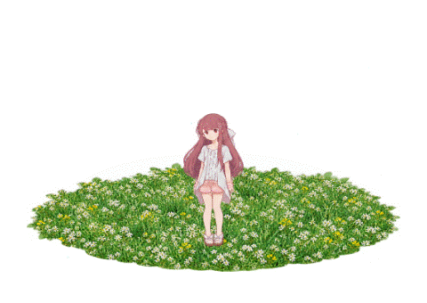
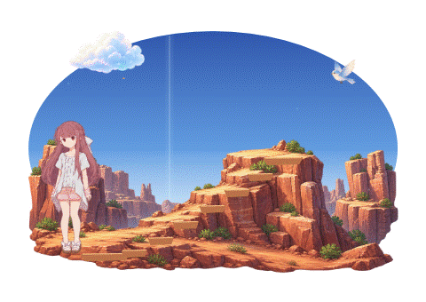

# Rin’s Little Shelter


一个安静的 Windows 桌面宠物。半Q版 Rin 会在桌面角落生活、回应鼠标，并用平板一点点创造小世界。

**公测预览 `v0.4.0-preview.2`：户外探索、白色创造与Shelter回顾。** [下载本版便携程序与完整源码素材](https://github.com/Fantasy708/Rins-Little-Shelter/releases/tag/v0.4.0-preview.2)。第12个陪伴日开放赭红砂岩山脉，第16日开放蓝色雪景与绿黄极光；自由模式立即可用。新增沿山径登顶、仰望极光和伸手接雪。第20日解锁记忆后，完整听完Shelter可观看约24秒的创造回顾，也可手动观看。原有卧室、草坡、秋千、父女记忆、九页来信与平板界面继续保留。实际检查与待实测范围见[发布状态](docs/发布状态.md)和[验证记录](docs/验证记录.md)。

本版已取消景物点击摇晃，并将创造过渡改为“景物位置汇聚 → 完整白色形状 → 原地实体化”，移除平板旁旧光片。进入小屋、坐长椅等交互及风车、天气等日常动画保留。下载后请用同一发行中的SHA256清单核对文件，完整解压后运行EXE并保留assets目录。

计划2026-10-16冻结新增功能，2026-10-18 12:00（北京时间）正式发布v1.0.0。本轮按用户授权在现有main分支创建v0.4.0-preview.2预览标签和独立发行，不新建分支；设置页仍标注“公测预览版 · 持续开发”。这不是v1.0.0正式版，也不代表一小时验收通过。已封存的本地`v0.4.0-preview.1`及更早版本继续保留。

项目仍在持续开发，后续会继续发布新版本、修复问题与完善体验。此前GitHub的`v0.3.1-preview.2`与其他历史预览保留原标签和附件，本轮不覆盖旧发行。

此前公测推广安排现细化为上方的v1.0.0发布计划。旧版文件中的旧“内测”字样属于当时文案，保留原样。

设计取舍、反馈修复和各轮更新过程见[开发日志](docs/开发日志.md)。

2026-10-15已补齐三个历史预览：[v0.2.0-preview.1 · 多场景与父女记忆](https://github.com/Fantasy708/Rins-Little-Shelter/releases/tag/v0.2.0-preview.1)、[preview.2 · 原片卧室与成长顺序](https://github.com/Fantasy708/Rins-Little-Shelter/releases/tag/v0.2.0-preview.2)、[preview.3 · 屋内场景修正](https://github.com/Fantasy708/Rins-Little-Shelter/releases/tag/v0.2.0-preview.3)。附件保留当时的程序和源码，适合回看开发过程；日常使用可下载上方的`v0.4.0-preview.2`。此前九个公开预览及发布日期见[历史发行索引](docs/发布状态.md#发行索引2026-10-15)。

来信译文继续依据用户提供的日文正文；图标原稿为`assets/app/rin-shelter.png`，程序使用同目录ICO。旧版的61秒运行与检查只代表旧EXE，不能沿用为新版结论；新构建的实际检查单独记录，不把短运行或绘图缩放视为一小时或原生桌面验收。


| 轻跃平台 | 边缘转身 |
| --- | --- |
|  |  |

预览由实际WPF绘图导出，不包含用户桌面背景。

## 启动

新版本地便携包为 `dist/local/v0.4.0-preview.2/release/RinsLittleShelter-v0.4.0-preview.2-win-x64.zip`，完整源码素材包与SHA256清单在同一目录。完整解压后打开 `RinsLittleShelter.exe`。程序已包含.NET运行环境，支持Windows 10（19041及以上）和Windows 11 x64，无须安装开发工具。保留旁边的 `assets` 文件夹。GitHub当前仍提供[上一版v0.3.1-preview.2](https://github.com/Fantasy708/Rins-Little-Shelter/releases/tag/v0.3.1-preview.2)，它不包含新增山脉、极地或白色粒子。

GitHub上已有的[v0.3.1-preview.1](https://github.com/Fantasy708/Rins-Little-Shelter/releases/tag/v0.3.1-preview.1)、[v0.3.0-preview.2](https://github.com/Fantasy708/Rins-Little-Shelter/releases/tag/v0.3.0-preview.2)、[v0.3.0-preview.1](https://github.com/Fantasy708/Rins-Little-Shelter/releases/tag/v0.3.0-preview.1)与更早发行保持原样。新版提供便携包、完整源码素材包及SHA256；preview.1已包含开场，但仍是旧来信摘要。

本工作区新版成品位于 `dist/local/v0.4.0-preview.2/RinsLittleShelter`。旧 `dist/RinsLittleShelter`、`dist/local/v0.4.0-preview.1` 与历史版本包保留。升级时先退出旧版，再运行新版；默认继续读取原有存档，陪伴进度、来信与两模式各场景布置保留。仓库当前公开，本轮没有上传、创建Tag或修改发行。

请保持程序与旁边的 `assets` 文件夹在一起。便携压缩包解压后即可使用。

初次打开先播放开场，结束后进入 Rin 和云台。右键 Rin → **进入自由创造**，即可看到完整的小世界。自由模式与成长模式拥有各自的布局，随时切回不会丢失成长进度。

## 启动开场

默认首次完整播放，之后播放简版。完整开场约14.4秒，在原有小世界窗口内依次呈现柔和星光、天空与草甸、Rin苏醒和观察、拿起平板、种子落地并开花，最后显示标题“Rin's Little Shelter”与“这里有一个正在成长的小世界。”，以微笑回应接回当前存档的场景。简版约3.1秒。开场默认静音，不覆盖整屏、不抢键盘焦点。

点击画面右下角 **跳过开场**，或使用托盘同名入口，即可直接进入桌面。在 **设置 → 启动开场** 中可选择“首次完整，之后简短”“每次完整播放”或“直接进入桌面”；同一设置页的 **重看开场** 可随时重新观看完整版本。

开场中的草甸与花只是临时画面，不提前解锁景物、不改保存布置、不产生来信，也不消耗创造次数。完成或用户主动结束后记住已看状态。隐藏、暂停、整理、切换场景或模式、全屏和锁屏等操作优先结束开场，恢复后不自动重播。正常陪伴、音频联动在交接后继续运行。


以上为实际WPF生产绘图导出，不读取桌面背景。完整设计、素材复用与检查边界见[开场动画设计](docs/开场动画设计.md)；程序窗口导出见 `docs/screenshots/startup-runtime.png`，来源版本以验证记录为准。更改版本号会生成新EXE，本预览版的最终构建、短运行及附件核对须单独记录，旧EXE检查不能沿用为新EXE通过。本版本一小时稳定性和原生Windows输入、真实系统缩放与多屏观感仍待实测。

## 日常操作

| 操作 | 效果 |
| --- | --- |
| 靠近 / 点击 Rin | 她看向鼠标，轻轻回应 |
| 拖动 Rin | 在小世界周围改变位置，放下后她会观察并返回 |
| 拖动云台或草地 | 移动整片小世界 |
| 点击花、云、小鸟、小屋 | 景物保持自然状态；Rin可观察小鸟，小屋可短暂亮灯，不再点击摇晃 |
| 点击长椅 | Rin 走过去坐下 |
| 右键 / 托盘 → 前往场景 | 切换已解锁的场景 |
| 点击小屋的门 | 进入屋内 |
| 点击秋千木座 | 走近、扶绳、坐下、轻荡、停稳、起身离开 |
| 右键 / 动作页 → Nurture·拥抱草地 | 在足够空旷的可见草地上，走近、收起平板、俯卧休息，再撑起返回日常 |
| 山脉中右键 / 动作页 → 沿山径登顶 | 沿石阶攀登，在山顶静观，转身并逐步下山 |
| 极地中右键 / 动作页 → 仰望极光 / 伸手接雪 | 站稳看极光，或抬掌接住少量雪晶再收手 |
| 点击屋内高窗、圆几或床铺 | 看天气、使用平板或在床沿休息 |
| 右键 / 托盘 → 请Rin创造 | 展开平板，选择、预览并确认景物 |
| 右键 / 托盘 → 查看平板消息 | 打开同一块平板的消息页 |
| 右键 → 整理小世界 | 拖动物件；右键物件可收起 |
| 右键 → 设置与世界图鉴 | 调整大小、透明度、天气、天空及联动 |
| 双击系统托盘图标 | 打开设置 |
| Ctrl + Shift + R | 显示或隐藏；快捷键被其他软件占用时使用托盘 |

透明空白、光点和天气特效不拦截下面的窗口。打开“鼠标完全穿透”后，Rin 和景物也不接收点击，可通过托盘的“恢复位置和鼠标交互”恢复。

所在显示器进入全屏时，桌宠自动隐藏；退出全屏后恢复。程序不抢键盘焦点。显示器断开后，位置会收回到可用工作区域。

## 成长

当天运行满15分钟计入一个陪伴日，同一天只计一次，无须连续打开。锁屏、休眠和暂停不计入；正常运行、全屏隐藏时仍计入陪伴。没有饥饿、惩罚或每日任务。

| 累计陪伴日 | 新景物 |
| --- | --- |
| 初始 | 云台 |
| 2 | 草地 |
| 3 | 花 |
| 4 | 小路 |
| 5 | 小树 |
| 6 | 小鸟 |
| 7 | 长椅 |
| 8 | 灯 |
| 10 | 云 |
| 12 | 风车 |
| 14 | 小屋 |
| 20 | 星光，完整小世界 |

解锁后，Rin 会在后续日常行为中自主创造景物，也可以从图鉴主动选择。场景动作随着对应景物解锁。主动创造邀请每天最多3次，默认间隔35分钟；平板界面可操作后20秒未回应便收起。实际点选、翻页或切到消息后转为手动会话，鼠标经过不算回应；菜单可随时手动打开。

## 平板创造与消息

Rin先拿起并展示手中的平板，屏幕连续展开到可操作尺寸。选择、预览、翻页与“创造”确认都在屏幕内；右键、托盘和图鉴进入同一流程，图鉴只是预选候选。确认后屏幕收回，Rin点触平板，光片与景物在实际生成节点出现，再观察并恢复日常。她仍可安静地自主创造，无须每次等待用户。

创造页每页最多四个候选，遵守当前场景与模式的解锁规则。隐藏景物重新展示时保留保存位置，已显示景物不重复生成。预览、切页和关闭不修改布置；生成前中断不补生成，生成后中断保留已产生的景物。

成长模式消息页初始显示 **“No messages in 2593 days.”**。2593是固定故事数字，与实际陪伴日无关。第20个陪伴日开放父女记忆；完整观看屋内或树下任一片段，父女结束、现在的Rin淡入恢复后，开放同一封“父亲留给Rin的信”。提前结束不算，重复观看不会新增信。自由模式立即可读，与成长模式分别保存故事和已读状态。

来信只在平板内有稳定的未读点，不自动打开、不弹窗、不发声音。主动点开正文并显示后才标记已读，之后可随时重读。正文显示“来自：爸爸 · 中文译文”，共九页、手动翻页，按用户提供的日文转写完整翻译，不提供回复或发送。阅读不会改布置、成长进度或消耗创造次数；旧存档的已读记录也保留。本轮没有重新逐帧核对原片，译文与依据见[平板消息界面设计](docs/平板消息界面设计.md)及[参考记录](docs/平板参考核对.md)。

点击关闭或Rin可收起。拖动、整理、切场景/模式、记忆、隐藏、暂停、锁屏、全屏隐藏和完全穿透也会关闭平板；恢复后不自动打开。平板不抢键盘焦点，屏幕外透明空白继续允许操作下面的窗口。

具体设计见[平板创造交互设计](docs/平板创造交互设计.md)和[平板消息界面设计](docs/平板消息界面设计.md)，两份均随便携与源码包交付。

### 白色粒子创造过渡

确认创造后，白色碎粒在景物即将出现的位置汇聚，先拼出树木、花朵或小屋的完整白色外形，短暂停留，再在原位置渐变成有颜色的实体；不再围绕平板或脚边播放创造光片。固定最多384粒，完整过渡不超过1.8秒，实体尺寸和落点保持稳定。Rin自主创造使用同一效果；原有58%创建事件、布置和计数不变。预览、翻页、取消与观察已可见物件不会触发完整生成。

粒子不拦截鼠标，不增加通知、声音、设置或音乐；暂停、隐藏、切景等强中断清除特效，恢复不重放旧光点。平板内关闭按钮在实际生成后只收起界面，已成景物保留，剩余短暂显形过程可以正常结束。设计与边界见[白色粒子创造设计](docs/白色粒子创造设计.md)。


同一最终EXE的[实际窗口导图](docs/screenshots/creation-runtime.png)也随包交付。独立旧档实际创造后重启，景物位置、成长、来信和备份保持，未重播旧粒子；两次各约一分钟，完整数据见验证记录，一小时仍待实测。

| 平板创造 | 平板消息列表 |
| --- | --- |
|  |  |


以上为生产WPF绘图导出的白底预览，消息列表与正文示例来自自由模式；成长初始仍显示固定2593空状态。

## 场景与父女记忆

### Nurture·拥抱草地

手动彩蛋致敬Porter Robinson《Nurture》标准封面的草地与俯卧姿态。Rin通过20个专用完整姿势屈膝、手撑地、放低身体、背向镜头、头朝右上脚朝左下、两臂展开俯卧，左向进入先真实转身，停留4.5秒后撑起并起身。保持长发与服装，不为露出正脸改变姿态。默认静音，不自动播放音乐或新增通知，也不加入随机日常。

仅在已解锁、可见且有足够空位的室外草坡或院子草地开放。家具、小路挡住或草地隐藏时入口禁用，不挪动或重置布置；当前院子草地深度不足以容纳展开的双臂，本版院子入口禁用；请在室外草坡体验。云台、卧室、家具坐姿和秋千活动不执行。拖动、创造、记忆、整理和切场景/模式优先取消；暂停、隐藏和全屏按原规则冻结。两模式布置与成长保持，重启不恢复半段动作。




以上为生产WPF绘图导出，真实EXE窗口导出见 `docs/screenshots/nurture-runtime.png`。参考、完整提示词和锚点说明见[Nurture素材制作](docs/Nurture素材制作.md)。

按“云台 → 屋内 → 屋外院子 → 室外草坡 → 山脉 → 极地极光 → 树下秋千”顺序开放：初始云台，第2个累计陪伴日屋内，第7日院子，第10日草坡，**第12日山脉、第16日极地、第20日秋千**。父女记忆与来信规则仍从第20日开始。自由模式立即开放全部内容。解锁不强制切换，请从「前往场景」选择。

### 山脉与极地

山脉依据原片截图中的赭红砂岩、纵向岩壁与平顶台地重绘，Rin使用24张专用上/下山姿势，沿石阶逐步登顶、静观、转身和下山。极地保留蓝色雪地、冰崖与青蓝冰柱，天空是缓慢漂移的绿黄极光；伸手接雪使用12张专用姿势。默认静音，不自动播放音乐，不增加通知。两场景不安排地板躺卧或无座晃腿。

| 赭红山脉 | 极地极光 |
| --- | --- |
|  |  |



以上来自实际WPF生产绘图。参考、透明贴图、完整提示词和锚点登记见[户外探索素材制作](docs/户外探索素材制作.md)。Rin也会在日常低频选择场景动作，不要求用户操作。拖动、平板、创造、记忆、整理、切场景或模式优先取消动作；隐藏、暂停、锁屏和全屏按原规则冻结，恢复不自动重开。

最终EXE实际窗口导出：[登山](docs/screenshots/mountain-runtime.png)、[接雪](docs/screenshots/polar-runtime.png)。两次独立短运行均约一分钟，正常退出、存档与备份保持；不代表一小时验收。

日常屋内保留现在的Rin卧室陈设：浅帘高窗、黑铁床架与粉色花纹床品、圆几、淡绿色柜子和蓝衫小熊。桌面适配采用明亮、干净的动画背景画法，暖玫瑰墙面、浅灰地砖和柔和日光，不再使用裂墙和污旧纹理。记忆时临时呈现幼年房间，结束后恢复现在的卧室。窗玻璃显示随昼夜主题变化的天空，天气在窗外呈现。屋内休息限于可见床铺的床沿坐姿，不会在地板躺卧、抱膝、无座晃腿、接花瓣、小跑或轻跃；动作页中不适合当前场景的动作不可选。

旧存档保留已访问院子的权利、陪伴日和布置；旧室内自定义位置/隐藏状态保留，只迁移仍在旧默认位置的家具。需要完整新布局时，可在设置图鉴中选择「恢复默认布置」，它只重置当前模式的当前场景。原有院子景物按原日期累计，进入院子后可创造已解锁物件。屋内第2日可从菜单直接进入，无须等待第14日小屋出现。

每个场景分别记住景物的位置与隐藏状态，成长和自由模式分别保存当前场景及布置。切回旧场景会恢复原布置。拖动草坡、房间或树荫可移动整片世界；基础场所与秋千永久保留，装饰可整理和收起。

在屋内或树下点击下方“查看记忆”，也可从右键、托盘或世界图鉴打开。树下呈现父亲陪小Rin荡秋千，屋内呈现父亲替她整理发饰。故事段约25秒，走近与停稳另计，默认静音，仅主动播放，不添加对白。

“结束记忆”可随时返回；切换场景、模式、整理或拖动也会结束记忆。荡秋千时点击Rin或“停下秋千”会先慢慢停稳。记忆中的人物、光线和临时陈设不会写入布局，结束后秋千仍然保留，可重复观看。

| 草坡 | 屋内 |
| --- | --- |
|  |  |


## 天空、音乐与彩蛋

天空默认随本地时间变化：05–09点清晨、09–17点白天、17–20点傍晚、20–24点夜晚、00–05点深夜。设置可固定天空，并选择晴、雨、风、雪。日常使用无需联网。

音乐联动默认开启，分析默认输出设备正在播放的声音，轻轻改变光点和动作。音量与低、高频能量只在内存中处理，不保存录音。系统声音包含播放器、视频和其他应用的声音，因此这些声音也会影响光点。

播放器提供 Windows 系统媒体信息时，曲名包含 Shelter 且作者包含 Porter 或 Madeon，会进入专属氛围。**第20个陪伴日开放父女记忆后**，接近完整听完歌曲，会在小世界窗口内播放约24秒的 **Shelter · 创造回顾**：Rin拿起平板，从云台、草地、小花逐步创造出小屋与星光，最后收起平板看天空。自由模式直接开放；不要求先读信或完整看过记忆，也不会因此解锁来信。右键、托盘或设置中的同名入口可手动观看，右下角可随时结束；未提供媒体信息的播放器请使用手动入口。不会自动播放音乐或附带原曲。

回顾为临时演出，不改变任何场景布置、成长、创造次数或消息状态；结束恢复原场景与角色位置。跳播、快进、切歌不算完整收听，同曲循环完整听完可再次触发。正在创造、移动、使用平板、记忆、整理、开场，或暂停、隐藏、锁屏、全屏、完全穿透时不抢占、不排队补播。场景/模式切换、平板等明确操作优先结束回顾，恢复不会自动重开。记忆解锁前沿用原先约45秒临时理想世界；右键“看看理想世界”仍保留。


默认静音、休息提醒关闭、开机启动关闭。可以手动开启轻音效、每小时一次休息气泡或登录启动。全屏时不显示提醒，也不补发积压提醒。

## 保存与恢复

正常存档位于 `%LOCALAPPDATA%/RinsLittleShelter/shelter.json`，每30秒保存，并在退出时保存。旁边的 `.bak` 文件用于恢复损坏的主存档。

存档包含陪伴日、今日计时、每个场景在成长与自由模式下的独立布局、当前场景、物件收藏、位置、设置，以及两种模式各自的记忆完成和来信已读状态。v0.3.1-preview.1另保存全局开场已看记录与播放设置，旧档缺失时采用首次完整默认值；切换成长/自由模式不重复首次开场。旧存档缺少新增故事字段时安全补充，不重置进度或布置；已达20日的旧成长存档需完整重看一次任意父女记忆来开放信件。平板展开、预选、页码和开场播放到一半的时刻不保存，重启按开场设置进入。可复制整个存档目录作备份。首次安装、测试和正常使用的存档相互独立。

找不到 Rin 时，使用托盘“恢复位置和鼠标交互”。没有音频设备或曲目信息时，其余陪伴功能继续工作。

## 设计基准

后续修改前先阅读 [设计文档](design.md)。项目理念是“凛不是宠物，而是创造世界的伙伴”，保持安静陪伴、创造、自由和温暖。根目录的 [开发指引](AGENTS.md) 要求每次改动先参考该文档。

## 源码与构建

源码在 `src`，测试在 `tests`，插画图集和资源清单在 `assets`。构建需要 .NET SDK 10.0.401；本工作区已准备 `.tools/dotnet`，SDK 不包含在便携包或源码压缩包里。

在项目目录打开 PowerShell：

```powershell
pwsh -File scripts/build.ps1 -OutputDirectory dist/local/v0.4.0-preview.2/RinsLittleShelter
```

构建前退出正在运行的发布版本。脚本运行核心与画面检查，再生成自包含程序与压缩包。没有本地工具链时，先运行 `pwsh -File scripts/bootstrap.ps1`：脚本从微软下载指定 SDK，核对 SHA512 后解压到项目的 `.tools`，不更改系统 SDK。首次恢复 NuGet 依赖也需要联网。也可以安装 [微软 .NET 10 SDK](https://dotnet.microsoft.com/en-us/download/dotnet/10.0)。

开发诊断参数与架构见 [开发说明](docs/开发说明.md)，素材提示词与来源见 [素材制作](docs/素材制作.md)，验收记录见 [验证记录](docs/验证记录.md)。

本地版本附件由 `pwsh -File scripts/package-release.ps1 -Version v0.4.0-preview.2 -ProgramDirectory dist/local/v0.4.0-preview.2/RinsLittleShelter -ReleaseDirectory dist/local/v0.4.0-preview.2/release` 从已构建EXE生成，包含便携包、完整源码素材包和SHA256；不重新编译EXE，也不上传GitHub。个人存档、本机工具链、原始测试日志、用户参考截图和宣传视频不纳入交付源码。

问题反馈请使用仓库Issues模板，提供版本、Windows环境、动作与复现步骤。

角色原作：Porter Robinson、Madeon、A-1 Pictures 的《Shelter》。形象参考 [官方角色页](https://www.sheltertheanimation.com/)。本项目使用新生成的插画素材，未附带原歌曲或原片音轨。

来源与许可范围见 [CREDITS](CREDITS.md)，软件依赖许可见 [第三方组件](THIRD-PARTY-NOTICES.md)。
