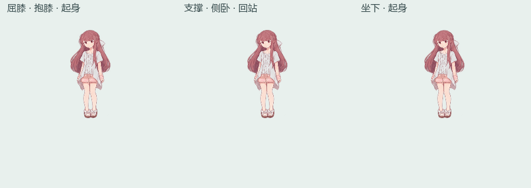
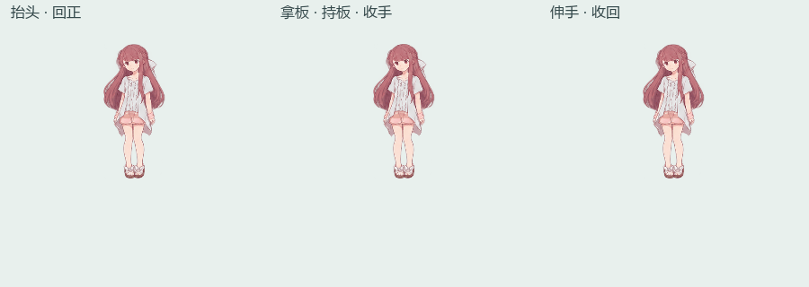
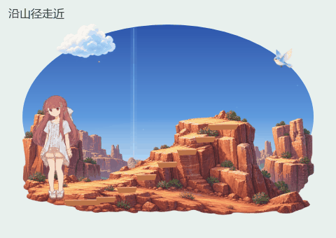
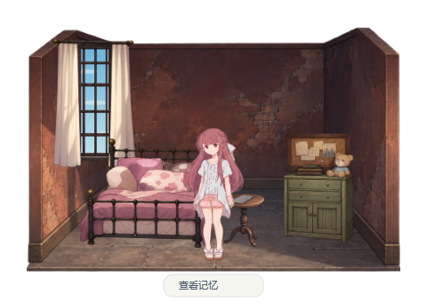
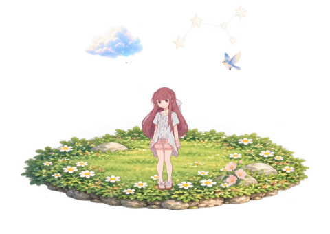
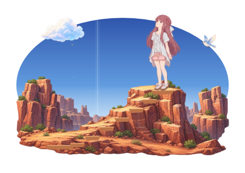
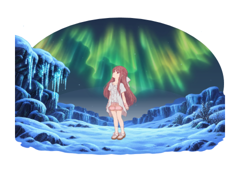
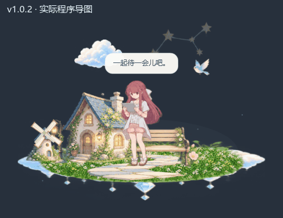
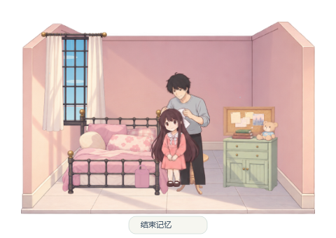
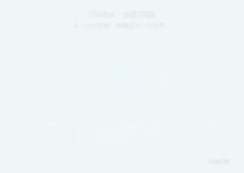

<div align="center">


# Rin's Little Shelter

这里有一个正在成长的小世界。

**v1.1.0 · 持续维护更新**<br>
《Shelter》十周年纪念 · 2026.10.18

[下载与发行](https://github.com/Fantasy708/Rins-Little-Shelter/releases) · [快速开始](#快速开始) · [使用指南](#日常操作) · [问题反馈](https://github.com/Fantasy708/Rins-Little-Shelter/issues)

</div>

> **v1.1.0 · 内存分配维护（已发布并核验）**：[下载与发行](https://github.com/Fantasy708/Rins-Little-Shelter/releases/tag/v1.1.0)。固定20轮普通步行交接分配减少约79%，画面与命中保持；同一EXE已完整通过61分钟运行。保留原存档、旧版本和Tag；实际附件更新状态见[发布状态](docs/发布状态.md)。

**本轮已测程序（532A2946…）：** 61分09.1秒、172044个动画循环，正常退出，21+36+31项监测及独立核验通过。平均46.963循环/秒，工作集平均633.342MiB、峰668.191MiB，仍有内存正趋势，不能认定长期无泄漏。维护源码请下载手工source.zip，自动Tag源码仍为原首发。边界见[验证记录](docs/验证记录.md)。

**此前Shelter十秒版（73396FCC…）记录：** 2026-10-27，对当时同一EXE另完成61分10.7秒独立存档运行检查，正常退出、进度与文件保持。平均动画循环46.571FPS，内存仍有轻微正增长趋势；完整资源及未测范围见[验证记录](docs/验证记录.md)。测试说明单独同步仓库与原v1.1.0发行正文，已发布程序、附件和Tag保持。

**此前十秒版验证（73396FCC…）：** 网易云开启SMTC后，已验证新EXE自动触发彩蛋并恢复日常；真实运行122.328秒、5307帧，另完成干净便携包61.637秒、2715帧短测及相关自动检查。10月27日对同一新EXE独立运行61分10.7秒、170666个动画循环，21项监测及36项独立检查通过。原生交互、多屏/DPI和设备切换等边界未由长测扩展，详见[验证记录](docs/验证记录.md)。

**此前长测为历史结果：** 更新前EXE（SHA256以`2B767B17`开头）曾实际运行61分08秒、172225帧，并完成真实音乐采集开关验证；这些结果不归到本次新EXE。完整过程及版本对应关系保留在[验证记录](docs/验证记录.md)。

**发布前本地候选阶段记录：** 10月27日继续优化普通步行交接，同一20轮切换的临时分配约减少79%，采样画面、动作和命中保持。自包含程序在`dist/local/walk-allocation-20261027/RinsLittleShelter`，仍为1.1.0，未做新EXE一小时测试；使用前退出原Rin，再运行候选目录中的EXE。公开发行保持原版，详情见[验证记录](docs/验证记录.md)与[内存风险排查](docs/内存风险排查.md)。

**前轮锁屏阶段记录：** 随后候选实际运行61分08.7秒，但约48.6分钟发生锁屏，未通过连续一小时条件。用户选择先保留本地、稍后再测，后续测试及GitHub发布暂停，不自动重试；压缩包保留运行前快照，本地包旁的`稳定性测试记录.md`和验证记录保存最新结果。

本版补齐38组动作的开始和回站过程，并统一人物比例与落脚：普通动作使用新制作的贴地、坐姿和上身中间姿态，小跑、轻跃和转身增加专用收尾；秋千、草地和平板保留各自的身体过程。登山双腿连续交替迈步，普通点击、结束观景或新请求后沿山径实际下山，回到山脚站稳再接下一项；拖动、场景/模式改变仍立即让位。实现和范围见[动作起止过渡](docs/动作起止过渡.md)与[38组检查表](docs/动作过渡检查表.md)。

屋内父女记忆沿用现在的粉色卧室，保留窗、床、圆几、柜子、已保存的布置和窗外昼夜天气。平板、拖动与记忆进出从当前实际画面接续；趴卧或秋千时选择新动作，会先起身或离座。此前`indoor-memory`、`action-bridges`、`climb-continuity`、`motion-exit`等本地包保留为开发历史，其更新统一纳入v1.1.0。完整内容见[发行说明](docs/releases/v1.1.0.md)，实际检查和待人工验收范围见[验证记录](docs/验证记录.md)。

| 贴地与坐姿起落 | 上身动作 | 山径往返 |
| --- | --- | --- |
|  |  |  |


## 写在十周年

在《Shelter》的世界里，Rin 用平板创造眼前的风景。Rin's Little Shelter 把这份创造带到了 Windows 桌面的一角：从最初的云台开始，草地、小花、长椅和小屋随陪伴逐渐出现，你也可以与她一起选择世界的样子。

项目的设计基准是：**“凛不是宠物，而是创造世界的伙伴。”** 她会观察、休息，走向山顶，或在极光下伸手接雪。你忙碌时，可以让她留在那里；想看看她的小世界时，再靠近一些。

2026 年 10 月 18 日，《Shelter》迎来十周年。Rin's Little Shelter 以 v1.0.0 首个正式版纪念这一天，将这份对原作的喜爱做成可以日常相伴的同人桌面作品。感谢 Porter Robinson、Madeon、A-1 Pictures，也感谢愿意让这个小世界住进桌面的你。

## 在这个小世界里

本次v1.1.0维护包纳入v1.1.0阶段的动作与记忆更新，以及连续白色创造、秋千和本轮音乐/会话修复；版号按维护者要求保留1.1.0。旧版本、附件及各轮本地记录均保留，实际检查见[验证记录](docs/验证记录.md)。

| 内容 | 你可以体验到什么 |
| --- | --- |
| 安静的日常 | 半 Q 版 Rin 回应鼠标、散步、观察和休息；默认静音，休息提醒与开机启动默认关闭 |
| 平板创造 | 在她手中的平板里选择、预览并确认景物，看细碎粒凝成连续白色形体，再原地逐区域显现颜色 |
| 成长与自由 | 按累计陪伴日逐渐开放内容，或切换自由创造，立即探索全部场景；两种模式独立保存布置 |
| 七个场景 | 云台、屋内、屋外院子、室外草坡、山脉、极地极光、树下秋千 |
| 记忆与来信 | 主动观看父女记忆，在平板中阅读和重读父亲留给 Rin 的信 |
| 昼夜与音乐联动 | 天空随本地时间变化，可选择天气；系统声音影响柔和光点和动作，支持 Shelter 专属氛围与创造回顾 |

日常使用无需联网。程序不附带《Shelter》原曲或原片音轨，也不会自动播放歌曲。

本页图片与 GIF 为现有版本的 WPF 生产绘图或程序窗口导出，不包含私人桌面背景；实际验收范围以[验证记录](docs/验证记录.md)为准。

## 快速开始

### 下载和运行

支持 **Windows 10（19041 及以上）与 Windows 11 x64**。便携程序自带 .NET 运行环境，无须安装开发工具。

**想使用安装脚本：** 在[正式发行](https://github.com/Fantasy708/Rins-Little-Shelter/releases/latest)下载 `RinsLittleShelter-Setup.zip`，完整解压后双击 `Install-RinsLittleShelter.cmd`。它会下载并校验最新正式便携包，安装到个人程序目录、创建快捷方式；无需管理员权限，保留现有存档。升级时再次运行，卸载可使用安装目录内的 `Uninstall-RinsLittleShelter.cmd`。自选目录、离线安装与更多说明见[安装说明](docs/安装说明.md)。

**一键卸载：** 便携包和Setup包均带`Uninstall-RinsLittleShelter.cmd`。先从托盘退出Rin，再双击卸载：便携包清理当前文件夹内未修改的程序文件，Setup包中的入口处理默认安装位置；两者均保留存档与自己添加/修改的文件。便携文件夹移动或改名后也可使用。请完整保留入口旁的PS1及支持文件。本次维护包在`dist/local/v1.1.0-maintenance-20261025/release`；此前v1.1.0卸载更新、旧附件归档与服务器核验保留为[发布历史](docs/发布状态.md)。

**继续使用便携包：**

1. 打开 [v1.1.0 维护发行入口](https://github.com/Fantasy708/Rins-Little-Shelter/releases/tag/v1.1.0)；[v1.0.0历史发行](https://github.com/Fantasy708/Rins-Little-Shelter/releases/tag/v1.0.0)、[v1.0.2](https://github.com/Fantasy708/Rins-Little-Shelter/releases/tag/v1.0.2)及[其他历史发行](https://github.com/Fantasy708/Rins-Little-Shelter/releases)继续保留。
2. 下载该版本的 Windows x64 便携 ZIP，并使用同一发行中的 `SHA256.txt` 核对文件。`source.zip` 是完整源码素材包，供开发和研究使用。
3. 完整解压 ZIP，打开 `RinsLittleShelter.exe`。请让 EXE 与旁边的 `assets` 文件夹保持在一起。

本次维护包名为 `RinsLittleShelter-v1.1.0-win-x64.zip`，完整源码素材包为 `RinsLittleShelter-v1.1.0-source.zip`；校验值见同一发行的 `SHA256.txt`。本次原8个同名附件按`before-maintenance-20261025`归档保留。维护源码应下载手工提供的`source.zip`或查看main对应冻结提交；GitHub自动生成的“Source code”ZIP/tar仍指向不移动的原v1.1.0 Tag。须完整解压，让EXE、图集、登记JSON和manifest配套使用。

升级前先退出旧版，再解压并运行新版。当前版本兼容既有存档，继续读取陪伴进度、来信状态和两种模式的场景布置；升级前也可按下文方法备份。

### 第一次见面

首次启动默认播放约 14.4 秒的完整开场，之后播放约 3.1 秒的简版。可以点击画面右下角或托盘中的“跳过开场”，直接进入桌面；在“设置 → 启动开场”中选择每次完整播放、首次完整之后简短，或直接进入桌面，也能随时重看。

开场结束后，从 Rin 和云台开始陪伴。想先看看完整内容，可右键 Rin → **进入自由创造**。自由模式与成长模式各自保存布局，切回成长模式时进度保留。


## 日常操作

| 操作 | 效果 |
| --- | --- |
| 靠近或点击 Rin | 看向鼠标，轻轻回应 |
| 拖动 Rin | 改变她的位置，放下后观察并返回 |
| 拖动云台、草地等基础场所 | 移动整片小世界 |
| 点击长椅 / 小屋的门 | 坐下 / 进入屋内 |
| 点击秋千木座 | 走近、坐下并轻荡；点击 Rin 或“停下秋千”可慢慢停稳 |
| 点击屋内高窗、圆几或床铺 | 看天气、使用平板或在床沿休息 |
| 右键或托盘 → 前往场景 | 切换已解锁的场景 |
| 右键或托盘 → 请 Rin 创造 | 在平板内选择、预览并确认景物 |
| 右键或托盘 → 查看平板消息 | 打开平板消息页 |
| 右键 → 整理小世界 | 拖动物件，右键物件可收起 |
| 右键 → 设置与世界图鉴 | 调整大小、透明度、天气、天空与联动 |
| 双击系统托盘图标 | 打开设置 |
| `Ctrl + Shift + R` | 显示或隐藏；快捷键被占用时可使用托盘 |

景物不会因点击而整张摇晃。入屋、坐长椅、观察小鸟、小屋短暂亮灯等交互，以及风车、天气等自然动画仍然保留。

### 与其他应用一起使用

默认关闭“始终置顶”，激活浏览器、文件管理器等普通窗口后，它们可以覆盖 Rin。在“设置 → 显示与环境”中可开启或关闭“始终置顶”，立即生效并在重启后保持；旧存档默认关闭。无论是否置顶，所在显示器进入真正全屏时，程序仍自动隐藏，退出后恢复；窗口不抢键盘焦点。

透明空白、光点和天气特效允许鼠标操作下层窗口。打开“鼠标完全穿透”后，Rin 和景物也不接收点击。需要暂时让开时，可使用快捷键或托盘隐藏；需要重新操作时，使用托盘中的“恢复位置和鼠标交互”。完全穿透只改变鼠标交互，不会隐藏画面。

## 按自己的节奏成长

当天有效运行累计满 **15 分钟**计入一个陪伴日，同一天只计一次，无须连续打开。锁屏、休眠和暂停不计入；正常运行、全屏隐藏时仍计入陪伴。没有饥饿、缺席惩罚或每日任务。

### 景物解锁

| 累计陪伴日 | 新景物 |
| --- | --- |
| 初始 | 云台 |
| 2 | 草地 |
| 3 | 花 |
| 4 | 小路 |
| 5 | 小树 |
| 6 | 小鸟 |
| 7 | 长椅 |
| 8 | 灯 |
| 10 | 云 |
| 12 | 风车 |
| 14 | 小屋 |
| 20 | 星光，完整小世界 |

解锁后，Rin 会在后续日常中自主创造景物，你也可以从图鉴主动选择。主动创造邀请每天最多 3 次，默认间隔 35 分钟；平板可操作后 20 秒未回应便收起。实际点选、翻页或切到消息后转为手动会话，鼠标经过不算回应；菜单入口可随时手动打开。

### 场景开放

| 累计陪伴日 | 场景 | 日常片段 |
| --- | --- | --- |
| 初始 | 云台 | 从一小片平台开始 |
| 2 | 屋内 | 窗边看天气、圆几旁用平板、床沿休息 |
| 7 | 屋外院子 | 布置已解锁的景物 |
| 10 | 室外草坡 | 在草地上停留，体验 Nurture·拥抱草地 |
| 12 | 山脉 | 沿石阶登顶、静观，再逐步下山 |
| 16 | 极地极光 | 仰望极光、伸手接雪 |
| 20 | 树下秋千 | 轻荡秋千，并开放父女记忆 |

自由模式立即开放全部内容。场景解锁后不会强制切换，请从“前往场景”选择。屋内第 2 日即可从菜单进入，无须等待第 14 日的小屋。

两种模式各自记住当前场景，以及各场景的物件位置与隐藏状态。切回旧场景会恢复布置；基础场所与秋千永久保留，装饰可以整理和收起。“恢复默认布置”只重置当前模式的当前场景。

| 屋内 | 室外草坡 |
| --- | --- |
|  |  |

| 赭红山脉 | 极地极光 |
| --- | --- |
|  |  |

“Nurture·拥抱草地”是致敬 Porter Robinson《Nurture》封面的手动彩蛋。在有足够空位的可见室外草坡上，从右键或动作页选择，Rin 会走近、俯卧休息，再起身。草地隐藏或被物件遮挡时不可用，不会为播放动作挪动布置；当前院子空间不足，该入口禁用。彩蛋默认静音，不加入随机日常，也不自动播放音乐。

## 平板里的创造

右键、托盘和图鉴都进入同一套平板流程。Rin 拿起平板后，你可以在屏幕内选择景物、查看预览，再点击“创造”；图鉴只预选候选，仍需在平板内确认。

细碎粒在景物即将出现的位置汇聚，连续白色形体逐渐凝结，短暂停留后在原位逐区域显出素材颜色。形体沿用景物真实的透明轮廓与内部空隙，生成前后保持同一层级和昼夜照明。Rin 自主创造使用同样的效果。候选遵守当前场景与模式的解锁规则，每页最多四项；已显示的景物不会重复生成，收起的景物重新展示时保留保存位置。

本次表现参考用户提供的 MV，并针对桌面尺寸适配；原有创造时点、布局和存档保持。这一视觉修订已纳入历史v1.0.2，并在本版保留。具体参考与验证边界见[白色创造设计](docs/白色粒子创造设计.md)和[验证记录](docs/验证记录.md)。

预览、切页和关闭不会改变布置。生成前中断不补生成，生成后中断保留已产生的景物。拖动、整理、切换场景或模式、隐藏等操作优先，恢复后不会自动重开平板。



## 记忆与父亲的来信

以下包含记忆与来信的解锁说明；希望自行发现时，可以跳过本节。

成长模式第 20 个陪伴日开放父女记忆。在屋内或树下点击“查看记忆”，也可从右键、托盘或世界图鉴进入：屋内是父亲替小 Rin 整理发饰，树下是父亲陪她荡秋千。故事段约 25 秒，走近与停稳另计，默认静音，仅由你主动播放，不添加对白。

记忆可以重复观看，也可随时结束。临时人物、光线和陈设不会写入布局，结束后恢复现在的 Rin 与原有场景。

屋内记忆沿用日常同一间粉色卧室及当前的家具位置、隐藏状态，窗外天空和天气继续显示。暖光与父女片段区分回忆氛围，不再覆盖旧木屋；提前结束也不会重置布置。



成长模式的消息页最初显示 **“No messages in 2593 days.”**。2593 是固定故事数字，与安装时间或实际陪伴日无关。完整看完屋内或树下任意一段记忆，等现在的 Rin 恢复后，就能在平板中打开同一封“父亲留给 Rin 的信”；提前结束不算完成，重复观看不会新增信件。

自由模式立即可读来信，两种模式分别保存故事与已读状态。未读提示只在平板内稳定显示，不弹窗、不发声音；打开正文后才标记已读，此后可以重读。

正文标注“来自：爸爸 · 中文译文”，共九页，手动翻页，依据用户提供的日文转写翻译，不作为官方中文原文。消息页不提供回复或发送；阅读不改布置、成长进度或创造次数。译文依据见[平板消息界面设计](docs/平板消息界面设计.md)与[参考记录](docs/平板参考核对.md)。

| 平板创造 | 平板消息 |
| --- | --- |
|  |  |

## 天空与音乐

天空默认随本地时间变化：05:00 至 09:00 清晨，09:00 至 17:00 白天，17:00 至 20:00 傍晚，20:00 至 24:00 夜晚，00:00 至 05:00 深夜。设置中可以固定天空，选择晴、雨、风、雪；屋内天气呈现在窗外。

音乐联动默认开启，分析默认输出设备正在播放的声音，轻轻改变光点和动作。音量与低、高频能量只在内存中处理，不保存录音；播放器、视频和其他应用的声音都可能影响光点。关闭音乐联动会停止采集。没有音频设备或媒体信息时，其余陪伴功能继续工作。

### Shelter · 创造回顾

网易云Windows客户端3.1.36需要在“设置 → 系统”勾选“开启SMTC”。未开启时，系统声音联动仍可能正常，但Windows没有曲名可供Rin识别。其它版本以实际设置为准。新版只需要曲名、作者和播放状态，不要求播放器报告歌曲进度或总时长。

播放器提供Windows系统媒体信息，且曲名包含Shelter、作者包含Porter或Madeon时，会进入专属氛围。成长模式第20日、父女记忆开放后，**识别到同一首Shelter并连续播放满10秒**，便尝试约24秒的创造回顾：Rin拿起平板，从云台、草地和小花逐渐创造出小屋与星光，最后收起平板看天空。自由模式立即开放；按约3秒查询一次的节奏，在达到10秒后的下一次查询触发。

也可以从右键、托盘或设置手动观看，并随时结束。回顾无须先看完记忆或读信，也不会解锁来信。临时演出结束后恢复原场景和角色位置，不改变布局、成长、创造次数或消息状态。

暂停、切歌、断联、隐藏、全屏、完全穿透或长时间未收到更新时重新计时，不补算过去时间；同一轮播放只触发一次。无进度的播放器无法报告同曲循环或跳播，自动条件只表示连续播放状态满10秒，不表示整曲完成。Rin忙碌时不抢占、不排队补播；播放器不提供媒体信息时，请使用手动入口。记忆开放前保留约45秒的临时理想世界与“看看理想世界”手动入口。



程序默认静音；音乐联动不等于播放音乐。轻音效、每小时一次的休息气泡与登录启动均可手动开启，提醒在全屏时不显示，也不补发积压内容。

## 保存、升级与恢复

正常存档位于：

```text
%LOCALAPPDATA%/RinsLittleShelter/shelter.json
```

程序每 30 秒及退出时保存，旁边的 `.bak` 文件用于恢复损坏的主存档。备份时，先退出程序，再复制整个 `RinsLittleShelter` 存档目录。

存档包含陪伴日、今日计时、物件收藏、设置、窗口位置、两种模式的当前场景与各场景布置，以及各自的记忆完成和来信已读状态；全局开场已看记录与播放设置也会保留。平板展开、预选、页码与播放到一半的动画不会保存。

旧存档缺失新增字段时会安全补充，不重置原有进度和布置。已达 20 日但缺少记忆完成记录的旧成长存档，需要完整重看一次任意父女记忆来开放来信。旧室内自定义位置与隐藏状态保留，只迁移仍在旧默认位置的家具。

找不到 Rin、窗口移出可见范围或开启完全穿透后，可使用托盘“恢复位置和鼠标交互”。显示器断开后，窗口会收回可用工作区域。

## 源码与构建

项目使用 **.NET 10 / WPF**，音频使用 NAudio。`global.json` 指定 .NET SDK **10.0.401**，允许同系列补丁版本；SDK 不随便携包或源码包分发。

| 目录 | 内容 |
| --- | --- |
| `src/` | 程序源码 |
| `tests/` | 核心逻辑、场景、故事、绘图与窗口接口检查 |
| `assets/` | 角色与场景图集、应用图标、资源清单 |
| `scripts/` | 工具链准备、构建、检查和打包脚本 |
| `docs/` | 设计细节、开发日志、发行与验证记录 |

在 Windows 的项目目录中，使用 PowerShell 7（`pwsh`）。没有本地工具链时，先运行：

```powershell
pwsh -File scripts/bootstrap.ps1
```

脚本从微软下载指定 SDK，核对 SHA512 后解压到项目的 `.tools`，不更改系统 SDK。也可以安装[微软 .NET 10 SDK](https://dotnet.microsoft.com/en-us/download/dotnet/10.0)。首次下载 SDK 与恢复 NuGet 依赖需要联网。

本次十秒识别维护构建使用`dist/local/v1.1.0-shelter-compat-20261026/RinsLittleShelter`。检查包含38组动作时序、相邻姿态变形和生产绘图；实际已完成范围以[验证记录](docs/验证记录.md)为准，不把脚本支持视为本轮全套通过。产品版本为1.1.0，程序集、文件及应用清单版本为1.1.0.0。

显式指定本轮独立路径的等价命令如下，旧本地及公开版本目录保留：

```powershell
pwsh -File scripts/build.ps1 -OutputDirectory dist/local/v1.1.0-shelter-compat-20261026/RinsLittleShelter
```

构建前请退出正在运行的发布版本。脚本执行核心与画面等检查，再生成自包含程序和压缩包。若需整理成发行附件，使用：

```powershell
pwsh -File scripts/package-release.ps1 -Version v1.1.0 -ProgramDirectory dist/local/v1.1.0-shelter-compat-20261026/RinsLittleShelter -ReleaseDirectory dist/local/v1.1.0-shelter-compat-20261026/release -ReleaseNotes docs/releases/v1.1.0.md
```

打包脚本复用已构建的EXE，生成便携ZIP、完整源码素材ZIP与SHA256清单，不重新编译，也不上传GitHub。本次维护原v1.1.0发行，原Tag不移动，旧同名附件归档保留；维护源码对应main冻结提交，自动Source code仍为原Tag。本次说明见[发行说明](docs/releases/v1.1.0.md)。

个人存档、本机工具链、原始测试日志、用户参考截图和宣传视频不纳入公开源码包。架构与诊断参数见[开发说明](docs/开发说明.md)；参与修改前请阅读[设计文档](design.md)与[开发指引](AGENTS.md)。

## 发布状态与问题反馈

本次v1.1.0十秒识别更新见[发行说明](docs/releases/v1.1.0.md)，新程序的运行、附件及GitHub核验分别登记在[发布状态](docs/发布状态.md)与[验证记录](docs/验证记录.md)。此前已发布维护EXE（摘要以2B767B17开头）的一小时及真实音乐检查保留为历史，不替代本次新SHA验收。原生桌宠交互、系统缩放、多屏和设备切换仍据各自实测范围，不以自动或离屏检查代替。

遇到问题，请使用 [GitHub Issues](https://github.com/Fantasy708/Rins-Little-Shelter/issues) 中的反馈模板，提供版本、Windows 环境、触发动作与复现步骤；涉及显示问题时，也请说明缩放比例和显示器情况。

正式首发之后，项目仍会继续修复问题、完善体验。已发布的预览版与历史附件保留，开发过程可查阅[开发日志](docs/开发日志.md)。

## 致谢与版权

Rin 来自 Porter Robinson、Madeon 与 A-1 Pictures 的《Shelter》。感谢原作带来的角色与世界，也感谢参与体验和反馈的人。

Rin's Little Shelter 是同人桌面作品，与原作官方无隶属或背书关系。角色设定参考[官方网站](https://www.sheltertheanimation.com/)，父女记忆参考[官方短片](https://www.youtube.com/watch?v=fzQ6gRAEoy0)。角色与场景插画由 imagegen 生成，并依据已有素材保持一致；未附带原曲、原片音轨或官网角色原图。Nurture 草地彩蛋致敬《Nurture》标准封面的草地与俯卧姿态，未附带摄影封面或歌曲。

本项目原创代码采用[非商业代码许可证](LICENSE)：允许非商业使用、研究、修改、编译和分享，分享时须保留版权、来源与许可证，修改版本须注明改动；商业用途须另获代码权利人的书面许可。它属于源码公开的非商业授权，不属于标准开源许可证。

授权仅覆盖项目作者有权许可的原创代码，不自动覆盖图片、图标等素材，也不授予《Shelter》的角色、名称、商标、音乐或其他原作权利。相关权利归各自权利人所有，第三方组件继续按各自许可证使用。

素材来源与使用边界见 [CREDITS](CREDITS.md)，制作记录见[素材制作](docs/素材制作.md)；软件组件许可见[第三方组件声明](THIRD-PARTY-NOTICES.md)及 `LICENSES/`。
