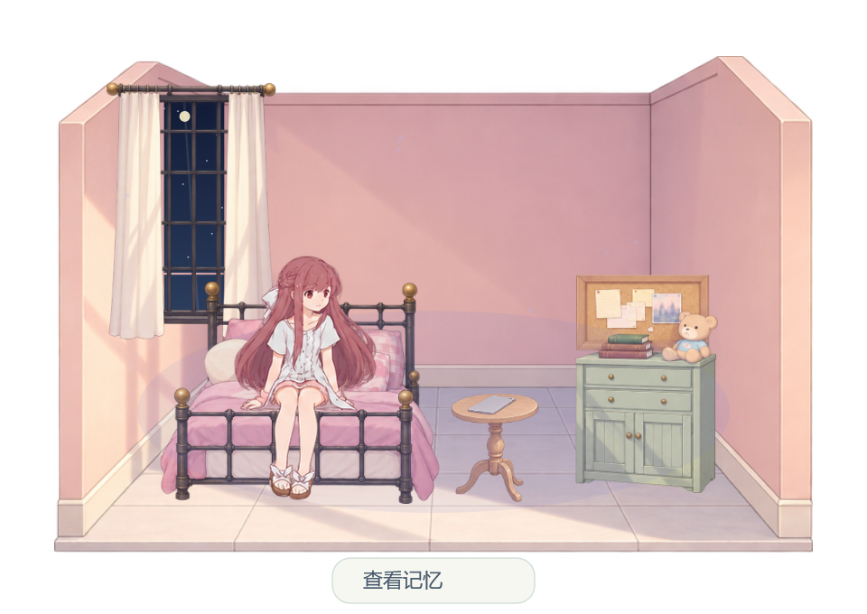
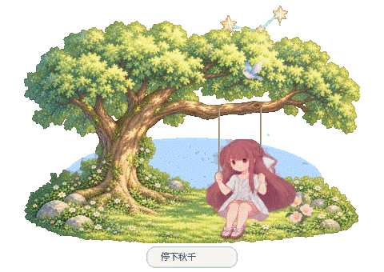

# Rin’s Little Shelter

一个安静的 Windows 桌面宠物。半Q版 Rin 会在桌面角落生活、回应鼠标，并用平板一点点创造小世界。

**`v0.3.0-preview.1` 已加入平板“创造 / 消息”界面，沿用五场景与父女记忆。** 本地构建、绘图与短运行检查完成；本次发布到现有私有仓库，旧版本保留。实际检查与仍待实测内容见 [发布状态](docs/发布状态.md) 和 [验证记录](docs/验证记录.md)。


| 轻跃平台 | 边缘转身 |
| --- | --- |
|  |  |

预览由实际WPF绘图导出，不包含用户桌面背景。

## 启动

本地便携包为 `dist/RinsLittleShelter-win-x64.zip`；版本附件位于 `dist/github/v0.3.0-preview.1`，完整解压后打开 `RinsLittleShelter.exe`。程序已包含 .NET 运行环境，支持 Windows 10（19041及以上）和 Windows 11 x64，无须安装开发工具。保留旁边的 `assets` 文件夹。

平板界面的发行入口为 [v0.3.0-preview.1](https://github.com/Fantasy708/Rins-Little-Shelter/releases/tag/v0.3.0-preview.1)，下载其中的 `win-x64.zip` 并完整解压。[v0.2.0-preview.4](https://github.com/Fantasy708/Rins-Little-Shelter/releases/tag/v0.2.0-preview.4)及更早版本保留，它们不包含本次平板界面。

本工作区成品位于 `dist/RinsLittleShelter`，便携包为 `dist/RinsLittleShelter-win-x64.zip`。升级时先退出旧版，再运行新版；陪伴进度与布置保存在本机用户目录，默认继续读取原有存档。仓库保持私有，下载需要有仓库访问权的GitHub账号。

请保持程序与旁边的 `assets` 文件夹在一起。便携压缩包解压后即可使用。

初次打开是 Rin 和云台。右键 Rin → **进入自由创造**，即可看到完整的小世界。自由模式与成长模式拥有各自的布局，随时切回不会丢失成长进度。

## 日常操作

| 操作 | 效果 |
| --- | --- |
| 靠近 / 点击 Rin | 她看向鼠标，轻轻回应 |
| 拖动 Rin | 在小世界周围改变位置，放下后她会观察并返回 |
| 拖动云台或草地 | 移动整片小世界 |
| 点击花、云、小鸟、小屋 | 轻晃、飘动、飞行或亮灯 |
| 点击长椅 | Rin 走过去坐下 |
| 右键 / 托盘 → 前往场景 | 切换已解锁的场景 |
| 点击小屋的门 | 进入屋内 |
| 点击秋千木座 | 走近、扶绳、坐下、轻荡、停稳、起身离开 |
| 点击屋内高窗、圆几或床铺 | 看天气、使用平板或在床沿休息 |
| 右键 / 托盘 → 请Rin创造 | 展开平板，选择、预览并确认景物 |
| 右键 / 托盘 → 查看平板消息 | 打开同一块平板的消息页 |
| 右键 → 整理小世界 | 拖动物件；右键物件可收起 |
| 右键 → 设置与世界图鉴 | 调整大小、透明度、天气、天空及联动 |
| 双击系统托盘图标 | 打开设置 |
| Ctrl + Shift + R | 显示或隐藏；快捷键被其他软件占用时使用托盘 |

透明空白、光点和天气特效不拦截下面的窗口。打开“鼠标完全穿透”后，Rin 和景物也不接收点击，可通过托盘的“恢复位置和鼠标交互”恢复。

所在显示器进入全屏时，桌宠自动隐藏；退出全屏后恢复。程序不抢键盘焦点。显示器断开后，位置会收回到可用工作区域。

## 成长

当天运行满15分钟计入一个陪伴日，同一天只计一次，无须连续打开。锁屏、休眠和暂停不计入；正常运行、全屏隐藏时仍计入陪伴。没有饥饿、惩罚或每日任务。

| 累计陪伴日 | 新景物 |
| --- | --- |
| 初始 | 云台 |
| 2 | 草地 |
| 3 | 花 |
| 4 | 小路 |
| 5 | 小树 |
| 6 | 小鸟 |
| 7 | 长椅 |
| 8 | 灯 |
| 10 | 云 |
| 12 | 风车 |
| 14 | 小屋 |
| 20 | 星光，完整小世界 |

解锁后，Rin 会在后续日常行为中自主创造景物，也可以从图鉴主动选择。场景动作随着对应景物解锁。主动创造邀请每天最多3次，默认间隔35分钟；平板界面可操作后20秒未回应便收起。实际点选、翻页或切到消息后转为手动会话，鼠标经过不算回应；菜单可随时手动打开。

## 平板创造与消息

Rin先拿起并展示手中的平板，屏幕连续展开到可操作尺寸。选择、预览、翻页与“创造”确认都在屏幕内；右键、托盘和图鉴进入同一流程，图鉴只是预选候选。确认后屏幕收回，Rin点触平板，光片与景物在实际生成节点出现，再观察并恢复日常。她仍可安静地自主创造，无须每次等待用户。

创造页每页最多四个候选，遵守当前场景与模式的解锁规则。隐藏景物重新展示时保留保存位置，已显示景物不重复生成。预览、切页和关闭不修改布置；生成前中断不补生成，生成后中断保留已产生的景物。

成长模式消息页初始显示 **“No messages in 2593 days.”**。2593是固定故事数字，与实际陪伴日无关。第20个陪伴日开放父女记忆；完整观看屋内或树下任一片段，父女结束、现在的Rin淡入恢复后，开放同一封“父亲留给Rin的信”。提前结束不算，重复观看不会新增信。自由模式立即可读，与成长模式分别保存故事和已读状态。

来信只在平板内有稳定的未读点，不自动打开、不弹窗、不发声音。主动点开正文并显示后才标记已读，之后可随时重读。中文正文标注“原作来信内容摘要”，共三页、手动翻页，不是父亲原话，不提供回复或发送。阅读不会改布置、成长进度或消耗创造次数。

点击关闭或Rin可收起。拖动、整理、切场景/模式、记忆、隐藏、暂停、锁屏、全屏隐藏和完全穿透也会关闭平板；恢复后不自动打开。平板不抢键盘焦点，屏幕外透明空白继续允许操作下面的窗口。

具体设计见[平板创造交互设计](docs/平板创造交互设计.md)和[平板消息界面设计](docs/平板消息界面设计.md)，两份均随便携与源码包交付。

| 平板创造 | 平板消息列表 |
| --- | --- |
|  |  |


以上为生产WPF绘图导出的白底预览，消息列表与正文示例来自自由模式；成长初始仍显示固定2593空状态。

## 场景与父女记忆

按“云台 → 屋内 → 屋外院子 → 室外草坡 → 树下秋千”顺序开放：初始云台，第2个累计陪伴日屋内，第7日院子，第10日室外草坡，第20日秋千，并同时开放屋内父女记忆。自由模式立即开放全部内容。解锁不强制切换，请从「前往场景」选择。

日常屋内保留现在的Rin卧室陈设：浅帘高窗、黑铁床架与粉色花纹床品、圆几、淡绿色柜子和蓝衫小熊。桌面适配采用明亮、干净的动画背景画法，暖玫瑰墙面、浅灰地砖和柔和日光，不再使用裂墙和污旧纹理。记忆时临时呈现幼年房间，结束后恢复现在的卧室。窗玻璃显示随昼夜主题变化的天空，天气在窗外呈现。屋内休息限于可见床铺的床沿坐姿，不会在地板躺卧、抱膝、无座晃腿、接花瓣、小跑或轻跃；动作页中不适合当前场景的动作不可选。

旧存档保留已访问院子的权利、陪伴日和布置；旧室内自定义位置/隐藏状态保留，只迁移仍在旧默认位置的家具。需要完整新布局时，可在设置图鉴中选择「恢复默认布置」，它只重置当前模式的当前场景。原有院子景物按原日期累计，进入院子后可创造已解锁物件。屋内第2日可从菜单直接进入，无须等待第14日小屋出现。

每个场景分别记住景物的位置与隐藏状态，成长和自由模式分别保存当前场景及布置。切回旧场景会恢复原布置。拖动草坡、房间或树荫可移动整片世界；基础场所与秋千永久保留，装饰可整理和收起。

在屋内或树下点击下方“查看记忆”，也可从右键、托盘或世界图鉴打开。树下呈现父亲陪小Rin荡秋千，屋内呈现父亲替她整理发饰。故事段约25秒，走近与停稳另计，默认静音，仅主动播放，不添加对白。

“结束记忆”可随时返回；切换场景、模式、整理或拖动也会结束记忆。荡秋千时点击Rin或“停下秋千”会先慢慢停稳。记忆中的人物、光线和临时陈设不会写入布局，结束后秋千仍然保留，可重复观看。

| 草坡 | 屋内 |
| --- | --- |
|  |  |





## 天空、音乐与彩蛋

天空默认随本地时间变化：05–09点清晨、09–17点白天、17–20点傍晚、20–24点夜晚、00–05点深夜。设置可固定天空，并选择晴、雨、风、雪。日常使用无需联网。

音乐联动默认开启，分析默认输出设备正在播放的声音，轻轻改变光点和动作。音量与低、高频能量只在内存中处理，不保存录音。系统声音包含播放器、视频和其他应用的声音，因此这些声音也会影响光点。

播放器提供 Windows 系统媒体信息时，曲名包含 Shelter 且作者包含 Porter 或 Madeon，会进入专属氛围；播放接近完整结束后展现约45秒理想世界。切换、跳过歌曲不视为完整收听。未提供媒体信息的播放器，可以右键选择“看看理想世界”。临时世界不会覆盖布局。

默认静音、休息提醒关闭、开机启动关闭。可以手动开启轻音效、每小时一次休息气泡或登录启动。全屏时不显示提醒，也不补发积压提醒。

## 保存与恢复

正常存档位于 `%LOCALAPPDATA%/RinsLittleShelter/shelter.json`，每30秒保存，并在退出时保存。旁边的 `.bak` 文件用于恢复损坏的主存档。

存档包含陪伴日、今日计时、每个场景在成长与自由模式下的独立布局、当前场景、物件收藏、位置、设置，以及两种模式各自的记忆完成和来信已读状态。旧存档缺少新增故事字段时安全补充，不重置进度或布置；已达20日的旧成长存档需完整重看一次任意父女记忆来开放信件。平板展开、预选和页码不保存，重启恢复日常。可复制整个存档目录作备份。首次安装、测试和正常使用的存档相互独立。

找不到 Rin 时，使用托盘“恢复位置和鼠标交互”。没有音频设备或曲目信息时，其余陪伴功能继续工作。

## 设计基准

后续修改前先阅读 [设计文档](design.md)。项目理念是“凛不是宠物，而是创造世界的伙伴”，保持安静陪伴、创造、自由和温暖。根目录的 [开发指引](AGENTS.md) 要求每次改动先参考该文档。

## 源码与构建

源码在 `src`，测试在 `tests`，插画图集和资源清单在 `assets`。构建需要 .NET SDK 10.0.401；本工作区已准备 `.tools/dotnet`，SDK 不包含在便携包或源码压缩包里。

在项目目录打开 PowerShell：

```powershell
pwsh -File scripts/build.ps1
```

构建前退出正在运行的发布版本。脚本运行核心与画面检查，再生成自包含程序与压缩包。没有本地工具链时，先运行 `pwsh -File scripts/bootstrap.ps1`：脚本从微软下载指定 SDK，核对 SHA512 后解压到项目的 `.tools`，不更改系统 SDK。首次恢复 NuGet 依赖也需要联网。也可以安装 [微软 .NET 10 SDK](https://dotnet.microsoft.com/en-us/download/dotnet/10.0)。

开发诊断参数与架构见 [开发说明](docs/开发说明.md)，素材提示词与来源见 [素材制作](docs/素材制作.md)，验收记录见 [验证记录](docs/验证记录.md)。

本地版本附件由 `pwsh -File scripts/package-release.ps1 -Version v0.3.0-preview.1` 从已构建EXE生成，包含便携包、完整源码素材包和SHA256；不重新编译EXE，也不上传或发布到GitHub。个人存档、本机工具链、原始测试日志和官方参考图不纳入交付源码。

问题反馈请使用仓库Issues模板，提供版本、Windows环境、动作与复现步骤。

角色原作：Porter Robinson、Madeon、A-1 Pictures 的《Shelter》。形象参考 [官方角色页](https://www.sheltertheanimation.com/)。本项目使用新生成的插画素材，未附带原歌曲或原片音轨。

来源与许可范围见 [CREDITS](CREDITS.md)，软件依赖许可见 [第三方组件](THIRD-PARTY-NOTICES.md)。
