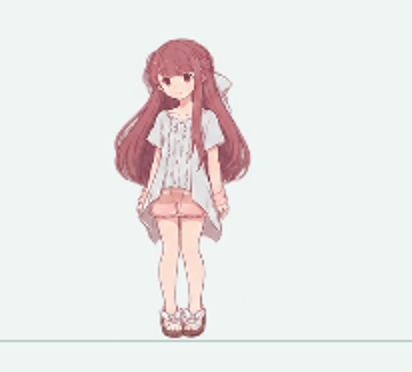
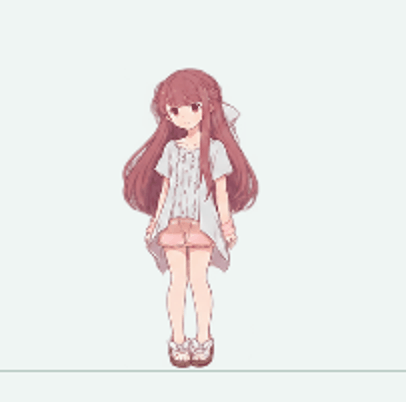

# 动作收尾过渡：小步跑、轻跃平台与边缘转身

2026-10-22～23，本地修订。沿用1.0.2程序元数据，未单独创建公开版本。本轮将“结束时回到站立”补成收脚、缓冲和回正的实际姿势链，保持“凛不是宠物，而是创造世界的伙伴”的安静表现。存档仍为版本1，不保存半段收尾，不增加动作目录项、成长条件或通知。

## 原因与改动范围

当前角色由`CompositionTarget.Rendering`驱动`Behavior.Tick`和`Scene`绘图，并非多个Storyboard控制同一依赖属性。原来的小跑、轻跃和转身素材已经过头身配准，但自然结束时仍直接换成下一动作；两张图的交叉淡化不能补出收脚、膝部回弹和重心回正。

`src/MotionExit.cs`给现有唯一`Behavior`增加短暂的收尾阶段；`src/SceneMotionExit.cs`绘制对应姿势。复用`src/MotionPoseFrames.cs`的完整连通画面配准、既有实际画面缓存与alpha命中规则。没有新增计时器、第二套角色状态机、骨骼模型或存档结构，也不替换其他动作原有的交接实现。

## 素材与参考

- 新图集：`assets/rin/motion-exits-v1.png`，1536×1024，RGBA透明PNG，24张完整人物姿势。
- SHA256：`7C9F9A30B57DF9AE837B27928F4350B3148DCC86765AAB590BB3F919E4396D38`。该摘要也登记在`motion-registration.json`的`SourceSha256`。
- 制作使用内置imagegen生成，保持原始生成PNG；载入时隔离单个人物连通画面，没有在制作后切下头、躯干或腿再拼贴。
- 原始参考为项目已有的基础姿势、小跑、轻跃、转身人物图集；外观承接这些素材的粉棕长发、白色蝴蝶结、浅色短袖上衣、粉色短裤和白色凉鞋。官网参考来源沿用`assets/reference/README.md`，本轮没有重新声称逐帧核对原片。
- 本机原始生成文件为`C:\Users\engio\.codex\generated_images\01a1260d-84af-7f00-a2ee-fed87b0c89fd\exec-5cbd4c34-e9ab-48af-b0fe-f0682f456c09.png`；运行和复现不依赖此本机路径，交付的是上面的PNG。

图集按制作顺序分四组六张：小跑接触相位A、小跑接触相位B、轻跃后缓冲、转身后回正。前两组是步态/手臂相位备选，不把生成结果称作严格的左右腿对称循环。转身组原画朝左，运行时按整段原始镜像方向使用；不会在同一姿势链中途再翻面。

### 生成提示约束

以下为制作要求的整理摘要，**不是原始提示词的逐字转录**：

> 参考提供的现有Rin人物图，制作同一角色的安静动作收尾精灵图集。保持半Q版插画、相同脸型、粉棕长发、白色蝴蝶结、浅色短袖上衣、粉色短裤和白色系带凉鞋；比例、线条和柔和光线与现有角色一致。透明背景，无场景、文字、编号、水印或投影地板。
>
> 制作6列×4行，共24个清楚分离、完整且不裁切的全身姿势，保留头发、双手和鞋的透明留白。第一行：从右向小跑的一个支撑相位减速，弯臂逐渐放下，后脚收回，重心稳定，恢复自然站立。第二行：提供另一个小跑接触/手臂相位的收脚备选。第三行：轻跃落地后的屈膝缓冲，手臂自然回落，膝与身体逐渐回正，再自然站稳；表现温和恢复，不再腾空。第四行：左向转身结束后肩髋、手臂、双脚和长发依次收稳，再回到日常站姿。
>
> 相邻姿势应有细小、真实的肢体变化；身体连接完整，脚底清楚，头部尺幅保持一致。不要通过整个人平移、旋转、压扁、透明叠加或重复同一张站姿充当动作；不夸张卖萌、摔倒或增加舞蹈动作。生成完整连通人物，供程序在统一地面锚点播放。

图集原始头身比例仍有生成差异，因此制作约束不能替代运行时的逐帧登记和实际绘图检查。

## 裁切、锚点与尺幅登记

`assets/manifest.json`的`MotionExitAtlas`和`MotionExitRegions`是运行时图集路径与24个裁切区域。生成图并非严格等格，长发会跨过名义网格，不能改为`Atlas.Grid(6,4)`。各区域来自原图alpha≥90的连通人物测量，外扩约3像素；归一化值保留微小正偏移，避免整数裁切原点因浮点误差少1像素。

下表记录此次源图测量边界，格式为`(x0,y0,x1,y1)`，单位为原图像素。真正载入范围以`MotionExitRegions`为准；`Atlas`随后仅保留最大完整人物连通区域及2像素抗锯齿边缘，排除相邻格的头发或鞋碎片。

| 索引 | 分组 | 源图测量边界 |
| --- | --- | --- |
| 0 | 小跑A | (62,19,239,274) |
| 1 | 小跑A | (307,18,483,274) |
| 2 | 小跑A | (543,17,704,273) |
| 3 | 小跑A | (777,14,946,274) |
| 4 | 小跑A | (1042,16,1214,274) |
| 5 | 小跑A | (1295,12,1458,274) |
| 6 | 小跑B | (58,278,237,535) |
| 7 | 小跑B | (298,279,481,536) |
| 8 | 小跑B | (534,278,706,535) |
| 9 | 小跑B | (777,278,948,535) |
| 10 | 小跑B | (1036,279,1222,535) |
| 11 | 小跑B | (1295,276,1458,534) |
| 12 | 轻跃缓冲 | (66,537,253,781) |
| 13 | 轻跃缓冲 | (296,540,480,781) |
| 14 | 轻跃缓冲 | (534,535,709,781) |
| 15 | 轻跃缓冲 | (781,538,957,781) |
| 16 | 轻跃缓冲 | (1046,537,1238,781) |
| 17 | 轻跃缓冲 | (1295,536,1458,782) |
| 18 | 转身回正 | (117,784,308,1019) |
| 19 | 转身回正 | (355,785,541,1019) |
| 20 | 转身回正 | (592,785,772,1016) |
| 21 | 转身回正 | (829,783,1013,1018) |
| 22 | 转身回正 | (1051,784,1243,1018) |
| 23 | 转身回正 | (1289,783,1461,1018) |

每一格的头部中心`HeadX`、发顶`Crown`、下颌`Chin`、髋部`Hip`、躯干/腿部尺幅以及落脚`Root`，按同一索引保存在`assets/rin/motion-registration.json`的`Stops[0..23]`。这些坐标基于**整数裁切后、尚未去除透明边缘的单元**，不能当作原PNG的绝对坐标；不能只修改manifest区域而忘记同步地标。

共同参照来自基础站姿0：头部31.0650887574、躯干57.2485207101、腿部61.6863905325逻辑像素，总计150。运行时对完整连通光栅做连续配准：头部等比、颈肩与髋部平滑接续，腿部区分尺幅与屈膝投影，不把弯曲姿势强拉到150像素。配准后的完整2倍分辨率画面在载入时生成并冻结，播放不逐帧解码或重做配准。

## 时序与首尾交接

小跑末段轻柔调整步态相位，使路线尽量在支撑点结束，路径仍到达原目标。用户中途请求其他动作时，小跑先执行0.16秒有界减速；轻跃与转身先完成原片段的落地/转向，再收尾。登山、草地和秋千内部使用的转身仍由各自原有行为回调负责，不强行插入这条普通动作收尾链。

| 动作 | 专用收尾时段 | 站稳时段 | 采用姿势 |
| --- | --- | --- | --- |
| 小步跑 | 0.30秒 | 0.07秒 | 按接触相位选择0～5或6～11 |
| 轻跃平台 | 0.22秒 | 0.07秒 | 14～17，避免落地后重复播放深蹲 |
| 边缘转身 | 0.30秒 | 0.07秒 | 18～23 |

上述索引是收尾播放槽位，并不表示每张原图都会直接出现在画面：

1. **首个槽位**保留上一帧真正已经显示的完整角色，包括当时的朝向、变形和落点，避免先退回某张图集旧姿势。冷启动离屏绘图没有上一显示画面时，按记录的原动作帧和离地高度重建。
2. **中间槽位**播放专用收脚、缓冲、手臂回落及重心回正完整姿势。所有肢体来自同一张不透明人物画面，不分层切腿。
3. **最后槽位与站稳时段**直接采用生产代码原本的基础站姿0，使用完全相同的根位置、朝向和轻呼吸。结束进入普通站姿时不再换成另一张“差不多”的生成站姿。

连续绘图已展示最后标准站姿时，`SceneActorTransition`在相同根和朝向下直接交给普通站姿，避免重复启动0.24秒通用混合、引入边缘重采样和额外延迟。如果退出被提前强制打断，或者最后标准帧从未实际绘制，则仍走原有安全交接。

**这条收尾链内部不做逐帧交叉淡化。** 双脚位置不同的图片叠淡会令旧脚、新脚同时变淡并出现双影；首帧实显、中间专用姿势和末帧标准站姿负责形体衔接。其他动作已有的短交接保持原规则，记忆虚化仍只用于记忆进出。

## 重复请求、中断与命中

- 当前完整移动动作被重复选择时不重新启动。收尾期间的新请求只替换最后一个待执行请求，不重启物理收尾；平板请求保留页面及预选物件，退出前不提前展开。
- 点击回应沿用原有语义，等待有界收稳后执行。自然结束没有用户请求时先站稳，不在空中直接进入自主创造。
- 拖动、整理、场景或模式变化优先取消收尾和待执行请求。拖动从用户抓住的实际画面立即跟随鼠标，不让窗口追赶延迟。
- 暂停、隐藏、锁屏、全屏等按原窗口规则冻结绘图；生命周期中断会取消尚未展开的平板请求，恢复后不自行打开。普通身体收尾按既有动作冻结规则继续，不重新从头播放。
- 命中依据当前实际画面：首槽使用实显快照，专用姿势使用配准后的alpha，末槽使用标准站姿。透明空白不因为旧姿势留有命中区域。

## 交付与验证边界

主要文件：`src/MotionExit.cs`（短阶段和时序）、`src/Core.cs`（唯一行为调度和最新请求）、`src/SceneMotionExit.cs`（实显首槽与完整收尾姿势）、`src/SceneActorTransition.cs`（标准站姿直接交接）、`src/Scene.cs`（素材载入与绘图入口）、`src/PetWindow.cs`（自动邀请不抢收尾）。资源是新增PNG、`assets/manifest.json`、`assets/rin/motion-registration.json`与导出的`assets/catalog.json`；PNG使用现有`MotionPoseFrames`配准，不另建动画框架。新增两套MotionExit测试，更新旧回归对自然收尾的预期，以及直接编译Core的测试项目文件。构建/打包/公开清单脚本和中文设计、开发、素材、验证说明同步交付。

`scripts/build.ps1`默认输出到独立的`dist/local/motion-exit/RinsLittleShelter`，并纳入`MotionExitTests`、`MotionExitVisualTests`；便携打包从构建后的manifest读取新增图集，完整源码包保留PNG、登记JSON、本说明和测试。先前`motion-registration`、`action-continuity`本地包和公开v1.0.2发行保留。

验证逻辑覆盖自然结束、主动切站、平板、点击、最后请求替换、重复请求、强中断和冻结恢复；生产绘图检查覆盖左右方向、30/60 FPS时间步与1.0/1.5/2.0绘图缩放，关注完整身体、支撑脚、不透明度、命中和标准站姿一致性。**这些是检查范围说明，实际通过数量及缺陷修正以本轮`验证记录.md`为准。** 本文不宣称原生Windows鼠标、真实系统DPI、多屏或一小时稳定性验收已经通过。

预览由生产`Scene`导出后编码为GIF，不把原始生成图集拼接当作程序播放结果：

| 小步跑收脚 | 轻跃后站稳 | 转身后回正 |
| --- | --- | --- |
|  |  |  |
