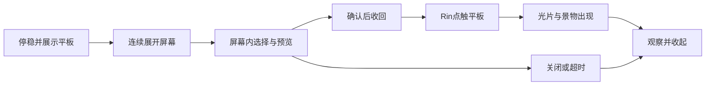

# Rin的平板创造交互设计

版本：`v0.3.0-preview.1`；整理日期：2026-10-13。本文件是已实现平板界面的设计基准；功能检查与人工实测范围以[验证记录](验证记录.md)为准。本次本地交付并按用户最新要求发布到现有私有GitHub仓库，旧版本保留。

## 设计目标

**凛不是宠物，而是创造世界的伙伴。** 平板是她与世界发生联系、也让用户参与创造的工具。用户的选择、预览和确认都在平板屏幕内，不能作为独立卡片漂浮在场景中。“创造 / 消息”两页共享同一块平板与开合动作，消息的规则见[平板消息界面设计](平板消息界面设计.md)。

界面保持安静、可忽略，不抢键盘焦点；用户可以关闭或不回应。Rin无需用户参与的自主创造继续保留，不把每次创造都改成任务或邀请。

## 一次完整的互动

1. **准备与展示**：Rin停稳；床沿姿势先回到当前场景地面。需要让出屏幕空间时，通过实际步行接近旁侧位置，再以专用姿势拿起并展示平板，不能直接平移整张人物。
2. **屏幕展开**：从手中实体屏幕连续投射出浅蓝白色操作区域，展开约0.65秒。手中仍只有一块平板；投射面、几何连接和实体屏幕保持对应，人物不跟随缩放或虚化。
3. **选择与预览**：屏幕内浏览当前场景可用景物，每页最多四项。点选显示柔和高亮、名称、小图与状态；用户可换选、切页或关闭。预览只存在于平板，不写入布置。
4. **确认与收回**：屏幕内“创造”只在候选合法且已选中时可用。一次确认锁定选择并停止接受后续确认；屏幕约0.55秒收回手中。
5. **点触与生成**：Rin以专用点触姿势操作平板，生成表演约1.4秒。在这段动作的58%节点由原有创建事件产生景物，与几何光片及柔光同步。不能在用户按下按钮时就创建。
6. **观察与收起**：看一会儿成果，再以专用姿势收起平板并恢复当前场景日常。正常动作保持人物不透明度稳定，不用透明度脉冲或半透明叠帧作过渡。

## 界面布局与命中

平板操作区域约280×200逻辑像素，保持在480×340小世界及所在工作区内。先决定靠Rin哪一侧，再展开；不覆盖她的脸，等待时不漂移。浅蓝白色界面、细边框与轻微反光呼应数字梦境；夜间适度降低屏幕亮度，文字仍清楚。

| 区域 | 内容 |
| --- | --- |
| 顶部 | “创造 / 消息”页签、明确的关闭按钮 |
| 中间 | 四个以内的景物候选、名称和缩略图 |
| 预览区 | 选中项说明；区分“已在世界中”和“重新展示” |
| 底部 | 候选页码、翻页、屏幕内“创造”；已在世界中的景物显示“观察” |

正文与按钮使用清楚的中文字体；消息正文14逻辑像素，内容不足时增加手动页数。绘制和命中读取同一屏幕布局，未展开到可操作阶段时不接收按钮输入。外壳、连接光线、屏幕外透明空白不承担选择命中；不增加覆盖整张桌面的透明遮罩。

## 入口、邀请与计时

| 入口 | 行为 |
| --- | --- |
| Rin主动邀请 | 同一平板流程，最多两个合适候选，优先尚未显示的已解锁景物 |
| 右键或托盘“请Rin创造” | 手动打开创造页，可按页浏览当前场景可创造内容 |
| 世界图鉴“创造/展示” | 打开平板并预选该景物，仍由用户在屏幕内确认 |
| 查看平板消息 | 同一开合流程，直接进入消息页 |
| Rin自主创造 | 安静使用现有创造行为，不必展开操作界面或要求参与 |

主动邀请每天最多三次；20秒未回应从界面进入可操作阶段开始，拿起和展开不计入。超时轻轻收起，不催促，不补发积压邀请。用户实际点选、候选翻页、切换页面或阅读信件后转为手动会话，持续到关闭或高优先级中断；鼠标仅经过不算回应。手动打开和阅读不增加主动邀请次数。

正在拖动、整理、记忆、秋千生活动作或创造时，不强行打开平板。关闭按钮或点击Rin可收起；所有可操作阶段仍支持高优先级用户操作。

## 场景、成长与布置

候选从当前模式、当前场景的现有可用物件规则产生。成长模式不提前开放景物；自由模式全部解锁，仍遵守场景适配。卧室不会推荐屋外树木或秋千，基础平台、房间和树荫不作为普通候选。没有候选时显示明确空状态，不用尚无实现的景物填充。

已显示景物可观察/展示，不重复生成；隐藏景物重新展示沿用保存位置，不重置布置。开屏、预览、切页、阅读及关闭都不修改布局。只有生成节点才沿用原创建流程保存；确认和生成前都再次检查当前场景、模式与解锁状态。两种模式和每个场景的布局、成长进度与旧存档兼容性保持。

## 中断与恢复

| 情形 | 处理 |
| --- | --- |
| 关闭、超时 | 放弃未确认选择，清除操作命中并收起；收回阶段不接受再次确认 |
| 拖Rin或平台、进入整理 | 立即关闭平板并取消旧目标；拖动落点服从新手势 |
| 场景/模式切换、开始记忆 | 取消旧会话，不能把目标生成到新的场景或模式 |
| 隐藏、暂停、锁屏、全屏隐藏、完全穿透 | 关闭并清除全部平板命中；恢复后不自动重开 |
| 确认后的连续点击 | 只接受首次确认，不重复调度、生成或计数 |
| 确认后、生成前中断 | 不保存尚未出现的景物，重开后不补生成 |
| 生成后中断 | 保留已生成景物，仅取消剩余表演 |

角色恢复使用当前场景地面规则，不沿用床沿坐姿高度。平板页面、预选、页码与展开动画只在内存中存在；重启从日常开始，不恢复一半开屏或未完成确认。

## 实现结构

`TabletSession` 属于现有 `Behavior`，只由单一状态机推进；阶段为接近、展示、展开、可操作、收回、点触、观察、收起，没有第二个人物定时器。会话记录当前场景、模式及代次，取消时推进代次并丢弃旧命中。

`SceneTablet.cs` 中的生产Scene绘制实体平板、连接投射、页签、候选、正文及操作区，并提供同一布局的命中。专用12姿势图集 `assets/rin/tablet-life.png` 登记手部与屏幕锚点；手中平板由绘图实时绘制，图集中不重复画一块实体。创建仍通过生产 `ObjectCreated` 事件写入世界，按钮不直接调用 `World.Create`。

两份设计、专用素材与完整源代码随便携和源码包交付。实际提示词与素材登记见[多场景素材制作](多场景素材制作.md)。

## 验收边界

本版本检查创造时点、重复确认、20秒计时、手动转换、各阶段取消、场景与模式匹配、旧存档，以及100%/150%/200%缩放下的生产绘图和命中。逐项通过结果及日志索引由最终[验证记录](验证记录.md)登记。

真实桌面点击穿透、托盘、拖动、全屏/锁屏、多屏与Windows缩放切换仍需对应实测；绘图导出不能替代实际桌面输入。短运行不能记作一小时稳定性通过。
