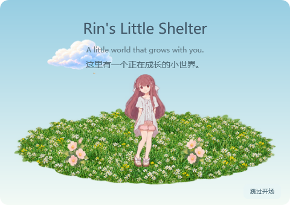
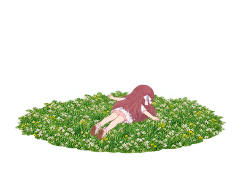
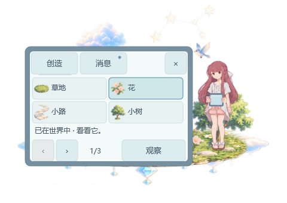
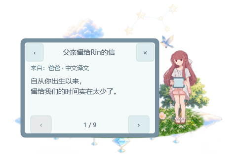

# Rin’s Little Shelter 开发日志

更新于2026-10-14，记录截至 `v0.3.1-preview.1`。这里记录功能如何形成、反馈如何改变实现，以及哪些检查已经完成。具体复现数据和验收范围保留在[验证记录](验证记录.md)。

项目一直围绕一句话展开：**凛不是宠物，而是创造世界的伙伴。** 她安静地观察、休息、使用平板，用户可以参与她的创造，也可以让她独自生活。每次扩展都要保留这种节奏。

## 2026-10-14｜v0.3.1-preview.1：以预览版交付开场

用户最新将开场版本改为v0.3.1-preview.1，并要求不新建分支，在原main创建新标签后上传。开场内容、素材与播放策略沿用既有实现，改版号后须构建新的EXE，并对新程序单独完成必要回归、旧存档短运行与附件核对；不能把v0.3.1旧EXE的摘要或检查记录改写成新版通过。当前检查状态以[验证记录](验证记录.md)为准，一小时及原生Windows输入、系统缩放、多屏仍待实测。

中文说明、开场设计、发布说明和打包默认版本同步为预览版。旧v0.3.1说明、标签及实际检查记录保留，不覆盖既有发行附件。

## 2026-10-14｜v0.3.1：进入正在成长的小世界（原版本准备记录）

用户提出启动开场，希望首次打开时能看见“这里有一个正在成长的小世界”，并要求画面与已有素材协调。本轮复用细草草甸、云和花，以及Rin的闭眼、看天、俯身和专用持板姿势：柔和星光里先出现天空与草地，Rin苏醒、观察，点触平板，让一粒种子落地、发芽、开花，再微笑回到保存的场景。首版没有另做挥手图集，以现有微笑收尾。

完整版本约14.4秒，默认首次播放，之后用约3.1秒简版。设置可改成每次完整或直接进入桌面，也可手动重看；画面和托盘都有跳过入口。开场静音、不覆盖整屏、不抢焦点，临时景物不提前解锁、不写布置，也不产生来信或消耗创造次数。全局已看记录安全补充到旧版存档，两种模式的故事与布局保留。

动画独立接入现有WPF绘图时钟，日常调度和音频在开场期间等待；主动操作与隐藏、暂停、锁屏、全屏等优先结束，恢复后不自动重播。人物在专用姿势序列内保持不透明，边界使用已有预乘RGBA方式过渡，避免此前出现过的透明闪烁。

745项开场检查覆盖策略、时长、旧档/备份、五场景与两模式交接、阶段中断、三档导出缩放、命中和角色合成。实际发布EXE的短运行与既有回归结果以[验证记录](验证记录.md)为准；一小时、原生Windows输入、系统缩放与多屏仍待实测。本轮按用户要求更新便携包并发布v0.3.1，保留原有发行与附件。

详细时序、素材复用和中断边界见[开场动画设计](开场动画设计.md)。

## 2026-10-13｜v0.3.0-preview.2：草甸与亲近自然的休息

本轮先完成本地交付与反馈修正；随后用户授权发布新版，并确认保持GitHub仓库当前公开状态，旧版本保留。[v0.3.0-preview.2](https://github.com/Fantasy708/Rins-Little-Shelter/releases/tag/v0.3.0-preview.2)已发布，附件是已测试便携程序、冻结标签源码素材包与SHA256。以Nurture标准版正式封面的绿草、小白花和自然日光为参考，新增手动“拥抱草地”动作。初稿仍像旧花环草坪、人物会随步行方向镜像，用户要求继续校正。最终重绘连续草甸，中央和边缘都有细草和小花，取消黄色空心区与花环边框。

对照用户cos参考，专用俯卧姿态改为背向镜头、头朝右上、脚朝左下、双臂展开。左右接近均固定朝右进入，朝左时先完成真实转身。20个完整姿势表现俯身、手撑地、放低、俯卧、撑起和起身，不旋转或压扁旧图片代替。只少量细草覆盖贴地边缘，正常人物不逐帧淡化。

展开双臂需要真实草地净空。草坡可以容纳，现有浅院子草地的远侧掌部会超出边缘，因此本版院子入口禁用，不强缩人物或自动改变布置。默认静音、不自动音乐、不加入随机动作。旧进度、两模式与各场景布置保持。

生产绘图检查含不同接近方向、移动草坡、昼夜和三档导出缩放；实际EXE另做独立存档短运行与重启。最终数据见[验证记录](验证记录.md)，短运行不能记为一小时或原生桌面输入验收。

## 2026-10-13｜v0.3.0-preview.1：把创造与消息放进平板

此前，创造选择会以独立选项出现在场景里。这次更新把它们收进Rin的平板，让选择成为她使用平板的一部分。流程从她拿起并展示平板开始，屏幕展开后，用户在里面选择、预览和确认；随后屏幕收回，Rin点触平板，景物伴随几何光片出现，她观察成果，再恢复日常。

右键、托盘和图鉴接入同一流程。图鉴可以预选景物，但仍需在屏幕内确认。已经显示的景物对应“观察”，隐藏的景物恢复原来的位置。预览和翻页不会改布局；真正的生成发生在点触动作的58%时点，重复确认不会产生第二份物件。

*生产WPF绘图的白底预览。*

### 让平板和角色连在一起

新增12张完整持板姿势，分别登记脚部、身高和双手锚点。实体平板放在手中，展开界面与它通过柔和的投射线连接。角色需要让出界面空间时，沿用实际步行；开屏和收屏不靠整个人平移完成。

这套流程由现有的单一角色状态机调度。拖动、整理、切场景或模式、查看记忆、隐藏、暂停和完全穿透都优先关闭会话，恢复后不会自动重开。Rin原本无需用户参与的自主创造也继续保留。

主动邀请仍然每天最多三次。20秒等待从屏幕真正可操作时开始，用户选择、翻页或切页后转为手动会话，不再继续倒计时；鼠标经过不算回应。

### 一封安静的来信

平板内增加“创造 / 消息”两页。成长模式初始显示固定的“No messages in 2593 days.”，这个数字不随着实际陪伴日增加。

第20个陪伴日开放父女记忆。完整看过屋内或树下任一片段，并等现在的Rin淡入恢复后，才开放同一封父亲来信。提前结束不算完成，重复观看也不会生成多封。自由模式立即可读，两种模式各自保存故事和已读状态。

来信只在平板内显示稳定的未读点，不弹窗、不发声音，也不自动打开。列表保持未读，正文实际显示后才保存已读；之后可以随时重读。正文采用14逻辑像素文字和三页手动分页，没有自动滚动、回复或发送入口。

*自由模式示例，正文明确标注“原作来信内容摘要”。*

制作正文时对照了官方短片结尾的来信画面。能够辨认的主题包括母亲亡故、Rin的成长给父亲力量、无法同行的遗憾，以及对她未来的相信。正文只保留这些主题的简短中文摘要，不署作父亲原话。初始小平板的英文和数字、结尾部分日文小字尚未逐字确认；2593沿用用户指定的固定文案，核对边界见[参考记录](平板参考核对.md)。

### 两个检查中发现的问题

第一处是文字越界。来信第三页最初写成四行，生产绘图检查发现正文挤入分页区域。最后压缩成三行，保持14字号，再重新检查全部页面。

第二处出现在确认或翻页后、下一次绘图前。原先清除旧按钮时连屏幕的命中区域也一起清掉，仍然可见的平板会短暂让点击落到背后的景物上，甚至取消尚未生成的创造。修复后，输入立即清除旧按钮，但可见屏幕继续遮挡点击；真正关闭会话时才清除整个界面区域。

### 验证与交付

| 检查 | 已完成范围 |
| --- | --- |
| 平板与故事逻辑，434项 | 邀请与超时、生成时点、重复确认、阶段中断、记忆完成与提前退出、模式隔离、已读与旧档恢复 |
| 生产WPF平板绘图，1325项 | 五场景、左右位置、三档导出缩放、文字与按钮边界、命中、握持锚点、脚部落点与身体不透明度 |
| 生产窗口接口集成，250项 | 实际程序入口关闭会话、恢复不重开、屏幕遮挡，以及生成、记忆完成和已读事件的即时存档 |
| 原有功能回归 | 57项核心、165项场景与记忆、671项场景绘图及34组动作回归 |
| 音频启停 | 默认输出设备三次真实WASAPI启停；本次系统数字静音 |

新解压便携包使用独立复制的旧存档，先在消息页运行60.9秒，再重启至创造页运行60.8秒。两次均正常退出、无异常日志，各采样间持续绘制，旧成长进度和各模式、各场景的布局保持一致。结束工作集约579～580 MB；这两分钟不能证明长期资源稳定，也不是恒定60 FPS的保证。

**本版本的一小时稳定性尚未完成。** 原生桌面拖动、下层窗口穿透、托盘与焦点、锁屏及全屏往返、真实多屏和Windows缩放操作仍待人工实测。从卧姿或床沿坐姿进入持板的主观衔接也需要继续观察。自动绘图和直接调用窗口接口，不算人工操作通过。

[v0.3.0-preview.1](https://github.com/Fantasy708/Rins-Little-Shelter/releases/tag/v0.3.0-preview.1)已发布到现有私有仓库，附便携包、完整源码素材包和SHA256清单。发行源码固定在标签提交 `762854f`，两个旧版本和附件保留。本日志是发行后的补充文档，不移动标签或重打包已经发布的附件。

## 2026-10-12｜v0.2.0-preview.4：让Rin有可以前往的地方

小世界扩展为云台、屋内、院子、室外草坡和树下秋千，按初始、第2、7、10、20个陪伴日依次开放。自由模式全部开放，每个场景和模式分别保存布置。切换场景增加了新的生活空间，也要求角色使用各自的地面落点，避免沿用院子高度而悬空。

秋千加入专用的扶绳、坐下、轻荡、停稳和起身动作，手、绳索、座板与身体共享运动锚点。屋内和树下增加用户主动打开的父女记忆；记忆中的陈设只临时呈现，退出后恢复原布局。

卧室经过两轮反馈调整：先让高窗显示随昼夜变化的天空，限制室内行为，取消地板躺卧、无座晃腿和户外动作；随后把阴暗、老旧的画面改为暖玫瑰墙面、浅灰地砖、奶油窗帘和柔和日光。陈设继续参考原片现在的Rin房间。

## 2026-10-11｜v0.1.0-preview.1：先把动作连接做好

早期反馈集中在腿部割裂、返回长椅像整个人拖移、坐姿落点错误，以及轻跃和转身生硬。修正围绕实际身体动作展开：晃腿保持从髋部到脚部完整连接；小跑换成独立姿势；返回长椅按实际路程迈步，到达前减速、站稳，再坐下；坐姿按臀部与椅面接触定位。

轻跃与转身各补充12个完整姿势，之后根据停顿反馈缩短播放时长。闪烁检查又发现，两个半透明姿势以普通叠加方式混合时，共同身体区域也会变淡。最终动作内部采用完整不透明帧，起止过渡使用预乘RGBA合成，并保存上一实际画面的快照。

这些反馈逐项写进[设计基准](../design.md)。后续扩展仍要先检查身体连接、接触点、姿势衔接和透明度，再增加新的行为。
