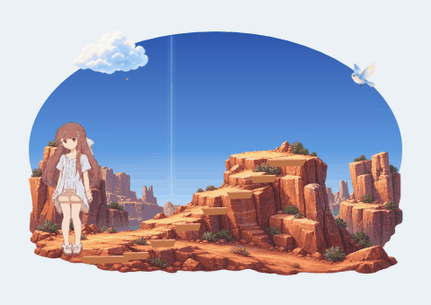
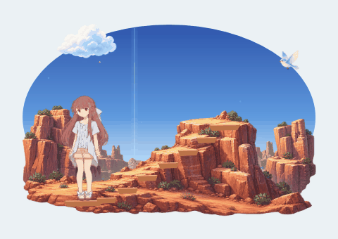
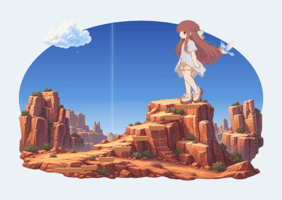

# 登山动作修复：连续交替迈步与统一体型

2026-10-23，本地修订，沿用1.0.2程序元数据。目标是让Rin自然地沿山径上行、下行并站稳，保持原有安静陪伴的节奏；不改山脉定位、场景大小、路线和用户布置。

## 诊断与采用的方案

旧登山使用若干完整姿势按格切换，素材头、躯干和腿的尺幅并不一致。按统一旧高度缩放或按每格包围高度归一，不能同时保证头身与屈膝投影。原路线在每步开头、结尾保留停顿，身体先停住再推进；如果同一条腿在候选图中反复抬起，增加格数也不会形成真正交替迈步。

制作期间尝试了多帧候选，但没有可靠画出近远腿轮换，**未将这些候选硬排成32帧原画**。本轮采用登山专用`ClimbLegRig`：从一幅完整已登记人物取得贴图，头、上衣、短裤和长发保持同一画面，两腿按连续髋—膝—踝—脚趾坐标变形。上山与下山共用同一身体源，朝向、落脚和关节目标随路线变化。

这只改变登山绘图与其原有Journey时序。没有把其他动作改成骨骼动画，没有新增角色状态机、独立定时器、声音、设置或存档字段。

## 运行资源与登记

| 内容 | 位置与含义 |
| --- | --- |
| 源PNG | `assets/rin/climb-body-v2.png`，保留原始生成PNG；运行仅取首个完整人物裁切作为唯一蒙皮源 |
| 裁切 | `assets/manifest.json`中的`ClimbRigAtlas`与单个`ClimbRigRegion`，按真实人物边界登记，不等分整图来播放 |
| 源人体地标 | `assets/rin/climb-registration.json`中的`Climb[0]`，含发顶、下颌、髋部、根位置和身体尺幅 |
| 关节 | 同JSON的`RigJoints[2][4][2]`，槽0为近腿、槽1为远腿，每腿依次为髋、膝、踝、脚趾 |
| 鞋底 | `RigSoles[2][2]`是两只源凉鞋的独立可见观察点；不以身体根伪装接触点 |
| 源骨段 | `RigBoneLengths`记录源图髋膝、膝踝长度，供核查；不代表三维测量或动作捕捉 |
| 历史资源 | `mountain-life.png`及旧`ClimbAtlas/ClimbAnchors/ClimbHeights`保留，不再用于本轮登山播放 |

源PNG SHA256为`248C6DE1724B7A060684C74C2B0F711F597E8D9375A14963283DAE55A52A46A7`，同时存于JSON的`SourceSha256`。素材外观承接现有粉棕长发、白色蝴蝶结、浅色短袖、粉色短裤及白色凉鞋；生成参考与提示记录见[素材制作](素材制作.md)。本轮没有声称重新逐帧核对原片中的登山动作。

登记坐标相对于实际整数Atlas单元`[70,87,238,413]`，在去透明边之前；它们不是原PNG绝对坐标。当前根为`[136.5,410]`，近、远鞋底分别为`[190,410]`、`[73,408]`。远腿被衣物和另一条腿部分遮挡，髋部归属由画面重叠关系推定；不能把这些二维地标当作精确三维骨架。

## 连续变形与接地

`MotionPoseFrames`先把完整源画面配准到基础站姿的共同尺幅：头约31.065、躯干57.249、腿61.686逻辑像素，总参照150。屈膝后的投影高度保留，不把整幅弯曲姿势拉到150像素。颈肩和髋部的坐标场连续接续，避免只改变某一半图片的大小。

`ClimbLegRig`在固定2倍逻辑分辨率画布中逆映射源腿部纹理。初始化时分出有界的大腿、小腿、整鞋纹理，避免一根骨段采到原图其他肢段。膝踝用原关节纹理在小范围连接，保留颜色、线条和不透明度；源图原腿区域从固定前景中移除，防止残留肤色碎片。原上身作为同一前景，按原遮挡关系覆盖腿根。运行复用固定像素缓冲与`WriteableBitmap`，不逐帧重读PNG、不积累无限位图缓存。

脚的目标角度变化时，`SoleOffset`检查整只真实凉鞋纹理的最低像素边缘；鞋跟与脚趾谁更低会随倾角改变，不能始终用原图一个点定位。`SceneOutdoor.DrawClimbFrame`据此计算踝点及膝部弯曲，并保持头身源一致。实际alpha、显示画面及命中仍经过现有Scene路径。

源图中被遮挡的纹理不能凭蒙皮恢复成真实新视角。髋部边缘、膝踝弯曲、凉鞋轮廓和交接时比例需用生产绘图检查，不能只凭关节坐标有限就认为画面自然。本说明记录方案，**不将尚未完成的接缝和比例验收写作通过**。

`JourneyWalk`与`JourneySky`分别登记此登山会话内的接近步行和山顶抬头；不影响其他场景普通动作池。抬头姿势保留头部倾斜的投影，不能把它较短的“头冠到下巴垂直距离”当作头变小再强行放大。身体尺度仍对齐共同躯干/腿参考。

登山家族进入和离开时沿用实际上一显示画面的安全交接，基础时长缩为约0.08秒，避免原0.24秒混合持续到下一动作中段。该短交接不是额外的手绘转头/站立动作；单帧放大仍可能看见短暂混合，不能声称所有姿势之间都没有轮廓重叠。登山循环内部使用单个不透明人物，不逐帧淡化。

## 路线与动作链

`Behavior.Journey`继续唯一持有并推进`OutdoorJourney`。动作链为：

走近山径 → 必要时转向 → 连续上山 → `summitSettle`收脚 → 看天静观 → 转向 → 连续下山 → `footSettle`收脚 → 日常站稳。

- 沿用原山脉的八个路线点；移动基础场所时路线跟随，空间不足时沿用不可执行规则，不重置用户布置。
- 每半步约0.6秒，当前支撑脚留在同一阶，另一条腿抬起、越过并落到下一阶，下一半步交换支撑。
- 身体根在前后双脚中点之间连续前进，与双脚共用真实时间，移除旧的每步40%停走区间。上、下行各使用适合的摆腿离地高度。
- 山顶、山脚的收脚阶段各约0.32秒。支撑脚保持，后脚收近，再进入原看天或站姿；不能在最后一阶直接跳换标准站姿。
- `PoseFrame`和目录中的16个时间相位用于诊断覆盖；**不是16张原画，也不把实际蒙皮限制为16个离散帧**。显示按原30/60 FPS调度与真实经过时间推进。

暂停、隐藏、锁屏及全屏按原规则冻结。拖动、整理、创造、平板、记忆、场景或模式切换保持既有优先级，取消专属会话并恢复当前场景落点；拖动保留抓取位移。成长、来信、场景解锁及两模式各场景布局仍使用原存档，不记录动作播到一半的位置。

## 构建、目录与预览

默认构建输出为`dist/local/climb-continuity/RinsLittleShelter`，便携及完整源码素材包位于同级`release`；旧公开发行及`motion-exit`等历史本地包保留。不要只替换EXE，新manifest、PNG及登记JSON须同时保留。打包脚本从已构建manifest动态读取`ClimbRigAtlas`与`ClimbRegistration`，不重新生成素材或编译程序。

资源目录第12版保留38动作、22物件、7场景。登山记录为1张源贴图、连续双腿蒙皮、关节/鞋底登记及16个诊断相位，`PoseFrames`为空，旧图集明确标为不播放；目录不是第二套调度器。

以下预览由实际生产Scene绘图导出后编码，不以原始图集拼接冒充运行效果：

| 完整登山链 | 连续上行步态 | 连续下行步态 |
| --- | --- | --- |
|  |  |  |

## 验收范围与限制

本轮需检查体型与头部尺幅、真实近远腿交替、指定支撑脚接地、摆腿离地、髋膝踝连接、鞋边、alpha命中、上下行交接及看天/站姿比例；同时检查移动后的山脉位置、空间不足、重复/快速触发、取消、冻结恢复和存档不变。时间步及1.0/1.5/2.0离屏绘图缩放检查不等同于原生系统DPI与桌面键鼠验收。

`ClimbContinuityTests`及既有户外、窗口接口和动作回归覆盖相关范围；**实际完成、结果与仍待实测内容见[验证记录](验证记录.md)**。本说明不预填测试通过数量，不把自动绘图或短运行写成一小时稳定性通过，也不声称有限二维蒙皮已成为完整骨骼动画系统。
